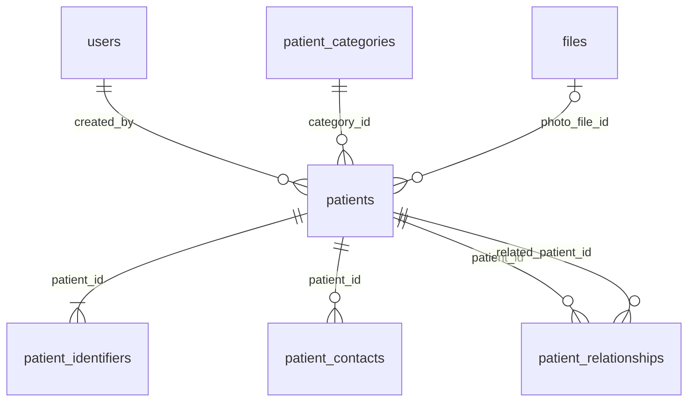
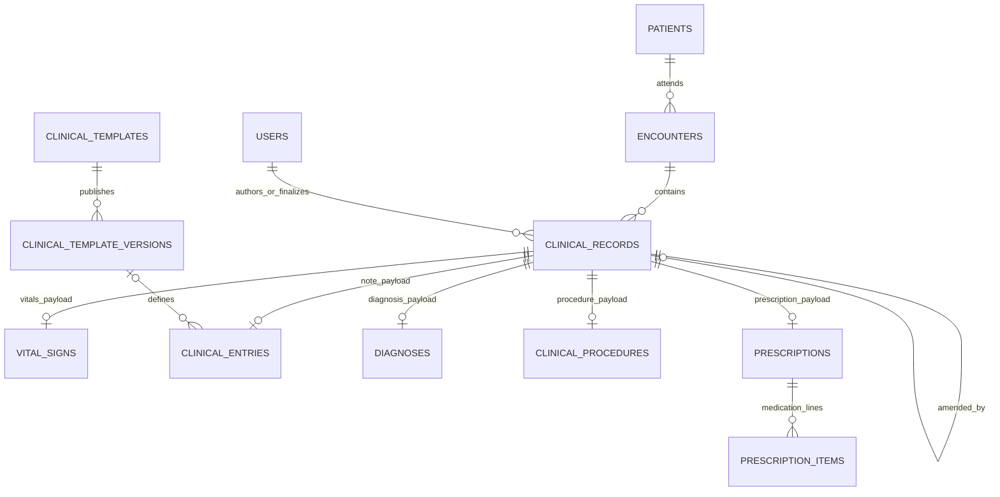

# EasyCare local development

This is the laptop development setup, separate from the eventual hospital-server deployment.

```text
easycare/
  backend/       Laravel PHP application and backend source
  easycare2/     Existing React + TypeScript frontend
  docs/          Architecture and development notes
  .tools/        Local PHP, Composer, MySQL, credentials and database files
```

Laravel belongs in `backend/`. `.tools/` contains development programs, not application source. It is excluded from Git. The backend's `.env` contains local configuration and is also excluded from Git. The setup uses project-local runtimes; it does not require adding PHP or Composer to your Windows system PATH.

## Start working

Open a terminal in `C:\Users\HP\Desktop\easycare\backend`:

```powershell
.\dev.cmd start
```

Open **http://localhost:8000** for the backend. The existing React frontend remains a separate application; start it from `easycare2` using `npm run dev` when working on the UI.

`start` launches the local database and backend in the background. They bind to your laptop's loopback address. After restarting Windows, run the same command again.

```powershell
.\dev.cmd status                  # Check installed versions and running processes
.\dev.cmd stop                    # Stop this local backend and MySQL instance
.\dev.cmd serve                   # Run Laravel in the foreground; Ctrl+C stops it
.\dev.cmd php -v                  # Check PHP
.\dev.cmd composer --version      # Check Composer
.\dev.cmd artisan --version       # Check Laravel
.\dev.cmd artisan migrate:status  # See which database migrations have run
.\dev.cmd artisan test            # Run the fast SQLite/in-memory suite
.\dev.cmd mysql                   # Open the local application's MySQL console
```

Use `stop` before switching from background `start` to foreground `serve`, because both use port 8000. Run `exit` to leave the MySQL console.

## What the tools do

| Tool | Purpose |
|---|---|
| PHP | Executes the backend code |
| Composer | Installs PHP packages from `composer.json` and `composer.lock` |
| Laravel | Organizes routes, controllers, models, validation and application services |
| MySQL | Stores shared application data |
| Artisan | Laravel's command-line tool, invoked through `dev.cmd artisan` |
| Migration | A version-controlled PHP file that creates or changes database tables |

The local database is named `easycare_dev`, with an application account restricted to that database. The generated password is already set in `backend/.env`; the helper reads the private local configuration when opening MySQL.

## Where you will write code

- `backend/routes/`: incoming web/API routes.
- `backend/app/Http/Controllers/`: HTTP request handlers.
- `backend/app/Models/`: database-backed models.
- `backend/database/migrations/`: database structure changes.
- `backend/tests/`: automated checks.
- `backend/.env`: private laptop settings, including the database connection.

The application migrations add staff/roles, audit history, private files, command confirmations and the patient storage foundation to Laravel's runtime tables. Staff login uses the existing session table. Patient APIs, screen integration and clinical workflows are later stages. The complete architecture SQL remains a proposal; it is not imported into the development database.

## Database and API foundation

Apply the application migrations and seed the reference catalogs:

```powershell
.\dev.cmd artisan migrate
.\dev.cmd artisan db:seed
```

The schema adds `departments`, `roles`, `permissions`, `user_roles` and `role_permissions`, plus staff identity fields on `users`. A department has many staff; staff have many roles through `user_roles`; roles have many permissions through `role_permissions`. Foreign keys prevent orphan relationships, unique keys prevent duplicate codes/assignments and MySQL checks require a positive staff version. Deleting a referenced department is restricted; deleting an authorization catalog record removes its pivot links, without deleting staff or the other catalog records.

The repeatable seeder adds seven initial department/role entries matching the current frontend modules and the thirteen known permissions defined in `config/authorization.php`. It applies each initial grant set once, tracked by `permission_baselines`. These are editable starting values; final hospital patient access rules still require agreement. Seeding preserves existing catalog names and subsequent grant/revocation decisions. It creates no staff accounts or staff-role assignments. Factories are for synthetic tests only. The initial counts are seven departments, seven roles, thirteen permissions, twenty-one role-permission links and four baseline markers. Seven starting patient categories are also seeded, without patient records or automatic patient-access grants.

The additive migration preserves existing staff IDs, passwords, email addresses and the original `name` column. Existing users receive `legacy_<id>` usernames and provisional split name fields; review these when staff account management is implemented. The application maintains `name` for compatibility when structured names change. Email is optional; its existing 255-character capacity is retained. The proposal's smaller email length and microsecond timestamps on existing starter columns are not retroactively imposed. Staff profiles/contacts and the other hospital tables will arrive with the corresponding features.

Rollback removes the foundation catalogs and added fields while retaining the starter user data. Because the starter schema requires email, rollback refuses before changing anything if any staff email is null. Assign valid addresses first when deliberately reverting to that schema. MySQL DDL is not fully transactional: a failed migration must be inspected before retrying; do not use `migrate:fresh` against the development or hospital database.

## Isolated test configuration

The default `artisan test` suite uses SQLite in memory for fast checks. MySQL is the authoritative database for dialect, constraint and migration behavior.

Create a private `.env.testing` from `.env.testing.example`, generate its own application key, and set its test password. Use a dedicated local MySQL database/account; the account must have privileges only on `easycare_test`:

```sql
CREATE DATABASE easycare_test CHARACTER SET utf8mb4 COLLATE utf8mb4_unicode_ci;
CREATE USER 'easycare_test'@'localhost' IDENTIFIED BY 'replace-with-your-private-test-password';
GRANT ALL PRIVILEGES ON easycare_test.* TO 'easycare_test'@'localhost';
```

The local workspace already has this isolated database/account configured. Credentials remain in the ignored `.env.testing`. On another machine, an administrator runs the SQL above and chooses the password; do not use the example text as a password.

```powershell
.\dev.cmd artisan key:generate --env=testing
.\dev.cmd artisan test --compact
.\dev.cmd php vendor/phpunit/phpunit/phpunit --configuration phpunit.mysql.xml --no-progress
```

Use the direct PHPUnit command for the alternate configuration; the installed Artisan test wrapper can supply a duplicate configuration option. MySQL tests reset the disposable test schema. Before migration/refresh traits run, the test base rejects cached configuration, non-testing environments, SQLite files, database URLs, remote MySQL hosts and any MySQL database/account other than `easycare_test`. The MySQL account's restricted grants add a second boundary. Do not enable parallel testing against this fixed database.

`.env.production.example` is a configuration template for the later hospital installation, with a separate database/account, HTTPS cookies and debug disabled. It does not provision or deploy a production server. Actual environment files, keys and database contents stay private.

On 10 November 2026, the full 85-table proposal and its 201 foreign keys were imported into a randomly named disposable MySQL 8.4.13 schema. The existing architecture suite passed 38 checks, including restrictive relationships, uniqueness, financial/clinical constraints and bed/stock row locking. Its test adapter was corrected for MySQL savepoint syntax and explicit transaction starts; synthetic string fixtures now respect declared column lengths. The schema itself did not need a DDL change. The disposable schema was removed afterward. The workspace runner and detailed results are in `../docs/architecture/verify_mysql.py` and `../docs/architecture/mysql-validation.json`; the installed Laravel foundation has its own reproducible PHPUnit suite described above. This verifies structural rules, not the unimplemented clinical services or complete concurrent hospital workflows.

## API contract: version 1

Base path: `/api/v1`. Send `Accept: application/json`; send JSON request bodies with `Content-Type: application/json` for write endpoints. JSON keys use `snake_case`. Successful resources are wrapped in `data`; paginated collections additionally include Laravel's `links` and `meta` objects. Return an empty collection as `200`, with `data: []`.

Implemented routes:

| Method and path | Access | Response |
|---|---|---|
| `GET /api/v1/health` | Public | `data.application`, `data.api_version`, `data.status`; `503` if MySQL cannot be queried. No database connection details are returned. |
| `GET /api/v1/auth/csrf-token` | Public, session-backed | `data.csrf_token`; starts an anonymous browser session. |
| `POST /api/v1/auth/login` | CSRF protected | Accepts `email_or_username` and `password`; returns `data.user`, `data.csrf_token`, `data.expires_at`. |
| `GET /api/v1/auth/me` | Active signed-in staff | Current identity, CSRF token and expiry; `401` for invalid sessions. |
| `POST /api/v1/auth/logout` | Active signed-in staff, CSRF protected | `204`, invalidates the current server session. |
| `GET /api/v1/departments` | Active signed-in staff with `reference-data.view` | Paginated department resources: `id`, `code`, `name`, `created_at`, `updated_at`. |
| `GET /api/v1/departments/{department}` | Same department-read permission | One department resource. |
| `GET /api/v1/staff` | `staff.view_any`, or `staff.view_department` with an assigned department | Paginated directory entries within the viewer's permitted scope. |
| `GET /api/v1/staff/{user}` | Scope policy for that staff record | One directory entry; inaccessible and missing staff IDs both return `404`. |
| `GET /api/v1/access-control` | `authorization.view` | `data.permissions` (code/name) and `data.roles` (code/name/permission codes), restricted to known permission codes. |
| `GET /api/v1/patients`, `GET /api/v1/patients/{patient}` | `patients.view`, active records only | Paginated patient summaries or a detailed demographic/contact resource. |
| `GET /api/v1/patients/options` | `patients.view` | Current category IDs/codes/names. |
| `POST /api/v1/patients/duplicate-check` | `patients.view`, CSRF protected | Up to twenty visible candidates and `meta.has_more`. No mutation. |
| `POST /api/v1/patients` | `patients.view` and `patients.create`, CSRF protected | Transactional registration, `201`; requires `Idempotency-Key`. |
| `PATCH /api/v1/patients/{patient}` | `patients.view` and `patients.update`, active records only, CSRF protected | Versioned demographic/contact edit, `200`; requires `Idempotency-Key`. |

The existing `/` response and framework `/up` route remain available. `/up` checks application liveness; the versioned health route also checks database readiness.

Department query parameters:

| Parameter | Rules | Default |
|---|---|---|
| `q` | Optional text, at most 100 characters; literal substring in code or name | No filter |
| `sort` | `code`, `-code`, `name`, `-name`; minus means descending | `code` |
| `page` | Integer, at least 1 | `1` |
| `per_page` | Integer from 1 to 100 | `25` |

Lists use an ID tie-breaker for stable ordering. SQL wildcard characters in `q` are searched literally. Unknown query fields are ignored and are not copied into pagination links. No department write endpoint is exposed at this stage.

The staff directory uses the same query bounds and pagination format. Its `q` searches name or username; allowed sorts are `name`, `-name`, `username` and `-username`, defaulting to `name`. Each entry contains only `id`, `name`, `username`, `staff_code`, `is_active` and department code/name/ID. It excludes email, credentials, roles and permission grants. Scope is applied before searching and pagination, so counts and search results cannot include inaccessible staff.

Errors always return JSON under `/api`, including requests without an Accept header. The shape is:

```json
{
  "message": "The submitted data is invalid.",
  "code": "validation_failed",
  "errors": { "per_page": ["The per page field must not be greater than 100."] }
}
```

`errors` is present for validation failures. Other errors contain `message` and `code`. API exceptions do not return stack traces, SQL text or exception messages, even when local debug is enabled. Validation messages remain readable so clients can display field errors.

| HTTP status | Code | Client behavior |
|---|---|---|
| `400` | `bad_request` | Correct the request |
| `401` | `unauthenticated` | Require sign-in |
| `403` | `forbidden` | Show access denied |
| `404` | `not_found` | Show missing resource |
| `405` | `method_not_allowed` | Use a supported method; `Allow` is preserved |
| `409` | `conflict` | Reload current state before resolving the conflict |
| `415` | `unsupported_media_type` | Correct the content type |
| `419` | `session_expired` | Renew the session and CSRF state |
| `422` | `validation_failed` | Display field errors |
| `429` | `too_many_requests` | Wait according to `Retry-After` |
| `500` | `server_error` | Show a generic error; inspect private server logs |
| `503` | `service_unavailable` | Retry later; investigate server/database readiness |

The API limiter permits 120 requests per minute per client IP. Revisit the limit with realistic shared-network usage before hospital deployment. Times returned by current resources are ISO 8601 UTC strings ending in `Z`. Future date-only clinical values must remain `YYYY-MM-DD`; future money and precise quantities should use decimal strings, with currency/units specified by each resource contract.

Foundation verification on 10 November 2026: all 51 PHPUnit tests passed on MySQL (138 assertions). The fast SQLite suite passed 50 tests (137 assertions), with the MySQL-only version-constraint test skipped. Coverage includes clean migrations, preservation/rollback of existing starter users, guarded rollback for missing email, relationship integrity, repeatable seeding, access denial, validation, pagination, CORS, sanitized failures and test-database isolation. The live health endpoint returned HTTP 200 with the configured frontend CORS origin. Task 10 subsequently extends the permission catalog and grants as described below.

## Server-side authorization

Laravel gates check explicit permission codes; model policies enforce record scope. Every current resource endpoint requires a valid active staff session and a gate/policy. The current-user and logout routes require the staff session itself. Frontend role guards do not authorize API requests. An admin role has no unconditional bypass: removing a permission removes its access. Unknown permission codes and wildcards grant nothing. Multiple assigned roles combine their known permissions without duplicates.

The initial permission presets are:

| Permission | Initial admin | Other six initial roles | Meaning |
|---|---|---|---|
| `reference-data.view` | Yes | Yes | Read department reference data |
| `staff.view_self` | Yes | Yes | Read one's own directory entry |
| `staff.view_department` | No | No | Opt-in directory access to staff in one's assigned department |
| `staff.view_any` | Yes | No | Read the complete staff directory |
| `authorization.view` | Yes | No | Read roles and their known grants |
| `staff.manage` | Yes | No | Read administration records and create/update staff accounts |
| `staff.reset_password` | Yes | No | Issue reset codes; also requires `staff.manage` |

An account without a role or grant can still inspect its own signed-in identity and log out, but has no resource access. Own-entry access alone does not allow enumeration through the staff list. Department access never treats an unassigned department as a group: a staff member without a department cannot use department-wide access. An explicit self grant and department grant form a union; a full-directory grant covers all staff. Caller-supplied department IDs cannot widen the scope. Unauthorized staff IDs return the same generic `404` as missing IDs.

Effective permissions are queried from the database on each request. Revoking a permission or staff-role assignment, or changing the viewer's department, affects subsequent requests in an existing session. Current-user responses also return fresh, sorted permission codes. Authenticated resource responses and failures use `Cache-Control: no-store, private`. Staff creation/update policies require `staff.manage`; department write policies and all staff deletion policies deny access.

Run these commands from the server console, using exact catalog codes:

```powershell
.\dev.cmd artisan access:role doctor
.\dev.cmd artisan access:role doctor staff.view_department
.\dev.cmd artisan access:role doctor staff.view_department --revoke
```

The first command only lists grants. The second grants department-directory access to everyone assigned the doctor role; the third removes it. Grant/revoke commands are idempotent and reject unknown roles, unknown codes and an unseeded permission catalog. Console access is an administrative boundary; the API exposes no grant or role-membership mutation endpoint yet. `staff:create --role=...` assigns an existing role without changing its grants.

For an existing development installation, run `artisan migrate` followed by `artisan db:seed`. Task 10 added `permission_baselines`; task 11 adds `staff_password_resets`. The seeder creates the catalog and applies each baseline in one transaction only when its marker is absent. The `staff-administration-v1` baseline explicitly grants the admin role the two new management permissions once. It preserves older read-permission revocations. Subsequent seed runs preserve removals and custom grants. Future grants need a deliberately defined new baseline or an explicit console grant. Retain baseline markers with database backups. Rolling back the marker-table migration removes its markers but leaves seeded grants; recreating and reseeding afterward would apply both initial baselines again. Do not reset markers to refresh catalogs.

These rules cover the implemented staff/reference APIs. Patient, encounter, prescription, stock and financial access rules are not implemented yet. Each new resource needs an explicit permission, model policy, database query scope and denial tests with its workflow. Department membership alone must never be assumed to grant access to clinical records. Hospital-specific access, emergency access, approvals and exports remain subject to task 2's decisions.

Task 10 verification on 11 November 2026: all 91 backend tests passed on MySQL (456 assertions); SQLite passed 90 tests (455 assertions), with one MySQL-only check skipped. Coverage includes all six ordinary role presets, explicit grants, admin revocation, null departments, inaccessible IDs, scoped search/pagination, unknown permissions, duplicate grants, failed initialization rollback and seed preservation of revocations. Database-backed session tests verify permission revocation and department changes without signing in again. A route audit checks authentication and authorization middleware on every current resource route. The additive migration and baseline are applied to `easycare_dev`, with no staff accounts or role assignments created; the live health endpoint returns HTTP 200.

## Frontend connection and authentication boundary

The frontend API client and tracked development configuration use `/api/v1`. Vite proxies this path to `http://127.0.0.1:8000`, so cookies stay on the frontend's hostname. The previous cloud API URL has been removed. Production hosting must route this same prefix to Laravel. `FRONTEND_URLS` remains an explicit origin allowlist for deliberately separate origins; development defaults are `http://localhost:5173` and `http://127.0.0.1:5173`. CORS supports credentialed requests, CSRF headers and preflight. CORS is browser configuration, not authorization.

For example, the frontend can check the public endpoint with:

```javascript
const response = await fetch('/api/v1/health', {
  headers: { Accept: 'application/json' },
});
const result = await response.json();
```

Session routes use Laravel's `web` middleware and the database session driver. The browser sends cookies with `credentials: include`. Before login or logout it retrieves the CSRF token and sends `X-CSRF-TOKEN`; Laravel's request-forgery middleware also accepts valid same-origin browser requests. Login rotates both session ID and CSRF token and destroys the old session. Identity cookies are HTTP-only, SameSite=Lax by default, and secure under the production template's HTTPS configuration. No bearer token is returned or required.

Unknown accounts, wrong passwords and inactive accounts receive the same `422` validation error. Laravel verifies the password hash. Login permits five failed attempts per normalized identifier/IP pair per minute, plus twenty login requests per IP per minute; `429` preserves `Retry-After`. Identity-specific limiter keys are hashed. Successful login clears its failure counter and records `last_login_at`. Login while already signed in returns `409`; logout is required before changing accounts. Extra input fields cannot assign roles or activate accounts.

`data.user` includes staff ID, username, names, email, active status, department, assigned roles, effective permission codes, `created_at` and nullable `last_login_at`. Passwords and remember tokens are omitted. `data.expires_at` is the current estimated session expiry in UTC. Protected routes check the active account and session password fingerprint. Disabling an account or changing its password prevents subsequent authenticated access. Logout invalidates the current session and regenerates CSRF state. Auth responses and API errors use `Cache-Control: no-store, private`.

The frontend uses one in-memory identity store shared by the global auth context and clinician components. It restores identity from `/auth/me` after reload and blocks private routes while identity is unknown or the server is unreachable. Module guards use server-returned roles; administration additionally requires `staff.manage`. UI checks do not replace backend policies. All active profile views use the server record. Profile changes go through staff administration; the old browser-only name, role and password editors are removed. No profile/password or patient record is written to browser storage. Obsolete authentication entry points use the same sign-in component; unsupported public signup/OTP hooks reject locally without requesting nonexistent APIs.

An access scope includes staff ID, department ID, active status, role codes and permission codes. A change resets the private React tree, including forms, contextual patient state and notifications. Registered cleanups clear module-level medical tables, pending entries, general-consultation state, patient flags and pharmacy callbacks. The boundary also revokes session-owned object URLs and removes only known legacy private keys (`easycare-auth`, `easyCareSession`, `mockUser`, `easyCareDoctorProfile`, `mockPatients`, `patients`) from local/session storage; unrelated preferences remain. Disabled browser storage does not prevent authentication. Metadata-only refreshes and reordered roles/permissions do not reset the scope or open forms. Clinical screens remain demonstrations and do not persist hospital records.

The API client captures the access revision before CSRF bootstrap, checks it before sending and before returning a response, and aborts pending requests on a boundary. A late success or `401` from the previous scope cannot populate data or sign out the new staff member. A write waiting for an old CSRF bootstrap is not sent under a new account. Aborting a browser request cannot undo a server operation that has already committed; writes are never automatically replayed after an account change. Only login/logout may refresh CSRF and retry once after `419`.

Sign-in, confirmed sign-out and completed recovery notify other tabs using a random event nonce through BroadcastChannel and a storage-event fallback. Notifications contain no identity or credentials and never authorize access: receivers clear private state and query `/auth/me`. Focus/visibility checks refresh the current session, and a restored browser-cache page blocks and verifies before reuse. Server-side access revocations are detected at the next API call or session check. Local expiry hides private content while the server check is pending. Idle pages do not send an endless heartbeat that keeps sessions alive. Logout waits for a server response; a failed logout can be retried. Browser history state from an earlier access scope is discarded before private routes render, including on back/forward navigation.

When adding another cache or request path, use the shared `apiFetch` client and register any module-level private cache with `registerSessionCleanup` in `src/lib/sessionScope.ts`. Create preview/download object URLs through `createSessionObjectUrl`. React component state belongs below `SessionBoundary`. Future patient APIs still need patient/encounter scopes, authorization policies and route-ID loading with their workflows; session isolation does not implement those services.

Run the frontend regression suite from `easycare2` with `npm test`. It uses Node's test runner and the already-installed TypeScript compiler to load production modules; no new dependency is installed. Verified runtime: Node 24.19.0. Eleven tests cover refresh preservation, permission changes, selective storage removal, storage-disabled operation, late responses, stale `401`, CSRF waits, connection uncertainty, object-URL revocation and clinical-cache separation. Type checking remains a separate check.

Task 12 verification on 11 November 2026: eleven frontend tests and twenty-five browser checks passed, with no browser page errors. The browser checks include multi-tab sign-out/account switching, server-backed profiles, preservation of same-account forms, history-state sanitization, restored-page verification, server role revocation and a storage-disabled expiry check that holds the server response while confirming private content is hidden. All 113 backend tests passed on MySQL (651 assertions); SQLite passed 112 (650 assertions), with one MySQL-only check skipped. The frontend builds. The complete type check reports 125 errors outside the changed files, so it remains an outstanding release check. One pre-existing unused declaration in a touched upload component was removed.

No public registration or OTP activation endpoint exists. Authorized administrators create accounts and issue recovery codes through `/admin/users`; staff redeem codes at `/forgot-password`. Patient and clinical screens still contain demonstration data; signing in does not make them operational or production-ready. Hospital patient-access decisions, complete audit history and clinical cache isolation remain on the checklist.

Create the first staff account from the server console:

```powershell
.\dev.cmd artisan db:seed
.\dev.cmd artisan staff:create --role=admin
```

The command privately prompts for username, names, optional email and a confirmed password. Usernames use lowercase letters, digits, dots, underscores or hyphens. Passwords require at least 12 characters, mixed case and a number, within bcrypt's 72-byte limit. Duplicate identifiers and unknown roles are rejected; creation and role assignment use a transaction. The role flag is optional and never defaults to administrator. Selecting a role does not add permission grants. Non-interactive execution is refused, keeping passwords out of command history and arguments. No staff account is automatically provisioned.

Verification on 11 November 2026: all 67 backend tests passed on MySQL (244 assertions); SQLite passed 66 tests (243 assertions), with one MySQL-only check skipped. Session tests use database-backed cookies and enable real CSRF verification instead of its usual test bypass. Eight browser checks passed: forged local identity, invalid credentials, login, refresh, role denial, connection failure/retry, logout and unassigned-role handling. No JavaScript page errors occurred. The frontend builds; its full TypeScript check still reports 126 errors outside the changed authentication files, so it is not a clean release check yet.

## Staff administration and recovery

The frontend screen is `/admin/users`. Its route and navigation require server-returned `staff.manage`, including when that permission is explicitly delegated to another role. All administration reads require this permission; writes also recheck the actor's current account and permissions inside the database transaction. Staff creation returns `201`; updates return `200`. No delete endpoint exists.

| Method and path, under `/api/v1` | Permission | Purpose |
|---|---|---|
| `GET /staff-management` | `staff.manage` | Search/paginate full staff administration records |
| `GET /staff-management/options` | `staff.manage` | Departments and roles, with each role's `assignable` flag |
| `GET /staff-management/{user}` | `staff.manage` | Current profile, assigned roles, effective permission codes and version |
| `POST /staff-management` | `staff.manage` | Create a staff account and assignments atomically |
| `PATCH /staff-management/{user}` | `staff.manage` | Update a profile and replace department/role assignments atomically |
| `POST /staff-management/{user}/password-reset` | `staff.manage` and `staff.reset_password` | Issue a one-use code after identity verification |
| `POST /auth/password/reset` | Anonymous, CSRF protected and throttled | Redeem a code and choose a password |

The administration list uses the directory's validated query parameters. Administration records include structured names, email, staff code, department, roles, active status, effective permissions, last login, creation time and `version`. They exclude password hashes, remember tokens and reset codes. Administration access permits these full profile reads; ordinary directory access still returns only the minimal directory resource.

Account creation accepts `username`, `first_name`, `last_name`, optional `middle_name`, nullable `email`, nullable `staff_code`, nullable `department_id`, `role_codes` (an array, which may be empty), `is_active` and the acting administrator's `current_password`. The nullable email, staff code and department fields must be present. Names are limited to 64 characters, username to 3-64 lowercase letters/digits/dots/underscores/hyphens, email to 255, and staff code to 64. Username, email and staff code are unique; department and role references must exist. Inputs cannot supply permissions or an initial password. The backend generates an unknown random initial password; issue a reset code separately after verifying the new staff member's identity.

Updates accept the same profile/assignment fields plus the latest `version`, without a username or password field. Usernames remain stable. Conflicting versions return `409` without partial writes; cancel and reload before editing the current record. Database uniqueness conflicts return validation errors. Reenter the administrator's current password for every save or code issuance; it is never stored in browser storage. Management mutations allow twenty requests per administrator/IP per minute.

A manager cannot assign a role containing permissions they do not hold, or modify/reset an account whose assigned permissions exceed their own. This also applies to inactive targets. Administrators cannot change their own roles, department or active status, or issue their own code through the API. Another administrator must perform those access changes. Staff mutations acquire a shared database row lock and recheck the actor after waiting, preventing two active administrators from concurrently deactivating each other and leaving no active manager. Transactions roll back profile and assignment changes together. Access changes remove the target's database sessions; subsequent requests must sign in again. Every profile update invalidates pending reset codes; a changed email also clears its verification timestamp. Reactivation allows a fresh sign-in and does not restore old sessions.

To issue a code, submit the target's latest `version`, the administrator's `current_password` and `identity_verified: true`. Only active targets are eligible. The response returns the updated `data.user`, `data.reset_code` and UTC `data.expires_at`, with `201` and `Cache-Control: no-store, private`. The code is 48 hexadecimal characters from a cryptographically secure random source, expires after 15 minutes, and replaces any previous code. Its SHA-256 hash, issuer ID and timestamps are stored in `staff_password_resets`, one row per staff member; the plaintext is returned only at issuance. Issuance increments the staff version but does not itself change the password. Closing the frontend panel removes its in-memory code display. Codes do not appear in URLs, local storage or later profile responses.

The verified staff member opens `/forgot-password` and submits `username`, `token`, `password` and `password_confirmation`. Passwords require at least 12 characters, uppercase/lowercase letters and a number, within bcrypt's 72-byte limit. Unknown, disabled, expired and wrong-code cases return the same validation error. Attempts are limited to five per username/IP and ten per IP per minute, with `Retry-After` on `429`. A successful reset consumes the code inside the transaction, changes the hash, rotates the remember token, increments the version and removes existing database sessions and legacy email-reset tokens. It returns `204`; staff must sign in with the new password. It does not activate disabled accounts. Password validation failures do not consume the code.

If the sole administrator has forgotten their password, an authorized operator with access to the trusted hospital server console can run:

```powershell
.\dev.cmd artisan staff:recover their-username
```

The command requires an interactive identity-verification confirmation and an active existing account. It displays a one-use code for private handoff, with the same expiry/redeem behavior; a null issuer identifies console issuance. It neither sets a shared password nor activates an account. Non-interactive execution and cancelled confirmation issue no code. Console access is a privileged recovery boundary and must be restricted by the hospital's operating procedure.

Run migrations and `db:seed` before using these endpoints. No email provider, internet connection or new package is required for recovery; clients still need a connection to the hospital server. The hospital must approve the identity-verification and console-operator procedure before production use. These workflows are implemented for local review; staff acceptance and production hosting are later checklist tasks. The separate audit trail described below preserves issuance and redemption events after the current reset code is replaced or consumed.

Verification on 11 November 2026: all 113 backend tests passed on MySQL (647 assertions); SQLite passed 112 tests (646 assertions), with one MySQL-only check skipped. Tests cover permission denial, profile/relationship validation, stale edits, rollback, self-access protection, privilege escalation including inactive accounts, repeated seeds, code hashing/expiry/replacement/reuse, password byte limits, throttling, console recovery and real CSRF-protected sessions. Nine browser checks passed: admin entry, creation with assignments, editing after refresh, verified code issuance/clearing, mobile recovery and code reuse denial, recovered-staff access denial, stale edits after a password change, deactivation/session invalidation and reactivation. No page errors occurred; desktop/mobile views were inspected. The frontend builds. Its full TypeScript check still reports the same 126 errors outside the changed files. At that task 11 verification, the development database had seven permissions, eighteen grants, two baseline markers and no staff accounts or pending resets; task 13 adds the independent audit permission baseline described below.

## Audit history

MySQL installation prerequisite: the migration creates two protection triggers and needs schema-level `TRIGGER` privileges. When binary logging is enabled, this migration also requires `log_bin_trust_function_creators=1` during installation. It checks this before creating the table and fails with a setup instruction if the setting is missing. The project-local development server now sets `log-bin-trust-function-creators=ON` in its private MySQL configuration; no global privileges were added to application accounts. On a hospital server, the database administrator must review and enable the setting for the migration window and can restore the previous value after the triggers are installed. Do not give the web application's database user `SUPER`. See [MySQL's stored-program binary logging rules](https://dev.mysql.com/doc/refman/8.4/en/stored-programs-logging.html). For a database-administrator session, the setting is:

```sql
SET GLOBAL log_bin_trust_function_creators = 1;
```

Task 13 adds local, append-only audit history for the implemented staff workflows. Run migrations and `db:seed` before using the updated application. The independent `audit-history-v1` grant baseline adds `audit.view` to the initial admin role once; later seeding preserves revocations. `staff.manage` does not imply `audit.view`, and the admin role has no bypass. A reviewer can hold only `audit.view` and open `/admin/audit` without staff-administration access. The Modules screen and administration navigation show the permitted links.

`GET /api/v1/audit-events` requires an active session and `audit.view`. It returns the normal resource collection with `data`, `links`, `meta`, plus a top-level `through_id`. Records are ordered by UTC `occurred_at` and then ID, newest first. Pagination defaults to the API page size and accepts at most 100 records. Filters are exact `action`, `outcome` (`succeeded`, `denied`, `failed`), `channel` (`http`, `console`), `actor_id`, `subject_type` (`staff`, `role`, `audit`), `subject_id`, and inclusive UTC `from`/`to` dates in `YYYY-MM-DD` format. A subject ID requires its subject type. `to` cannot precede `from`. Carry the returned `through_id` into subsequent page requests to keep the same upper ID boundary while new activity is recorded. Refresh omits that boundary and returns current history. Permission denial, validation and private/no-store responses follow the existing API contract. There are no audit edit/delete endpoints or export functionality.

Events contain the action, outcome, source, UTC time, server-generated request UUID, actor ID, logical record type/ID and a strictly allowlisted `safe_summary`. Rejected HTTP requests also contain their final status code. Staff names, usernames, emails, request bodies/headers, IP addresses, browser identification strings, passwords/hashes, CSRF values, session IDs and recovery codes/hashes are not copied into audit records. Profile summaries identify which fields changed without storing their personal values; access summaries retain previous/current role codes, department IDs, active flags, version and session-revocation outcome. Role-grant summaries contain the known permission code and whether the command changed an existing grant. A no-op command is still accountable.

| Action | When recorded |
| --- | --- |
| `staff.created` | HTTP or console account creation; rejected HTTP/console creation requests |
| `staff.updated` | Profile/access changes and rejected HTTP update attempts |
| `staff.recovery_issued` | Admin or trusted-console issuance; rejected requests and console cancellation |
| `staff.password_reset` | Successful redemption and rejected HTTP attempts |
| `role.permission_granted`, `role.permission_revoked` | Console grants/revocations, including no-ops and rejected codes |
| `auth.login`, `auth.logout` | Sign-in/out and rejected requests, including CSRF and throttling failures |
| `audit.viewed` | Successful history reads and rejected read attempts |

Successful staff mutations, recovery and console permission changes insert their audit event in the same database transaction. If the audit insert fails, the mutation rolls back, including password/reset-code/session-table changes. Console permission commands share the staff-management row lock. Login records its last-login timestamp and audit event together; an audit failure invalidates the attempted session. Logout ends the session before recording its event, so audit-storage failure cannot keep staff signed in. Rejected HTTP attempts are recorded after their mutation transaction has rolled back. If the database is unavailable, the request fails and no claim is made that an audit event could be persisted. HTTP auditing covers the listed routes; ordinary reference-data reads, session refreshes, seeding and direct database maintenance are not recorded as staff actions.

Actor/subject IDs are historical logical references, deliberately without cascading foreign keys. This differs from the proposal's actor foreign key and preserves the original reference if an account is removed during maintenance. A null actor with `channel: console` identifies the trusted server-console boundary, not an authenticated staff identity; the hospital must separately control and account for operating-system access. Password redemption uses a null actor and the target staff ID because possession of a recovery code does not establish a signed-in actor. Unknown/failed sign-ins do not look up or store the submitted identity.

MySQL and SQLite triggers reject row updates and deletes. The application exposes only authorized reads and trusted inserts. This is application/database protection, not cryptographic proof against a database administrator: privileged schema operations can bypass triggers. Retention, backup/restore, operating-system operator identity and hospital approval remain deployment decisions. The current audit scope contains no patient/clinical workflows; those stages must add their own approved event summaries and permission tests.

Verification on 11 November 2026: all 140 backend tests passed on MySQL (840 assertions); SQLite passed 139 tests (839 assertions), with one MySQL-only check skipped. The 27 new audit cases cover privacy, permission changes, pagination, console attribution, immutable rows, and rollback of staff/recovery/permission changes when audit storage fails. Twelve frontend regression tests and thirty-nine real browser checks passed, with no page errors. The production build passed; 125 pre-existing TypeScript errors remain outside changed files. Synthetic browser accounts were removed after desktop/mobile inspection. At task 13 verification, development had eight permissions, nineteen grants, three baseline markers and no staff accounts, pending resets or audit records; task 14 adds its separate file permissions baseline.

Repeat the browser acceptance checks with synthetic staff in the isolated test installation: create/edit a staff account and issue/redeem a recovery code, then verify the actor, target, outcome and safe details in `/admin/audit`; filter by action and UTC dates; page through history while another session creates activity; Refresh to include it. Test empty results and an interrupted connection/retry on desktop and mobile. An ordinary staff account must receive route/API denials. A custom role with only `audit.view` must land on the audit screen and remain unable to manage staff. Revoke that permission while the screen is open: the next request must clear its rows, and reload must not restore them. Sign-out/account changes must remove private audit content.

## Protected files

Task 14 provides the shared private-file foundation at `/admin/files`. The current scope is files owned by the signed-in staff member. No cross-staff file permission or patient/encounter attachment is exposed yet. Patient workflows must later attach records through their own approved patient policies; submitting `patient_id` or `encounter_id` now is rejected. The existing patient document demonstrations are not connected to this staff-owned library.

Run migrations and `db:seed` before using it. A separate `protected-files-v1` baseline adds `files.view_own` and `files.upload` to the initial admin role once. It preserves later revocations and does not grant other roles file access automatically. Grant the exact permissions through the trusted `access:role` command when approved. Upload requires both permissions; listing, metadata and downloads require `files.view_own`. File-only custom roles can enter their library without staff-management or audit permissions. Even administrators cannot read another staff member's file through these endpoints. Inaccessible and nonexistent IDs return the same `404` after the permission check.

| Endpoint | Result |
| --- | --- |
| `GET /api/v1/files` | Paginated list of the current staff member's files, newest ID first |
| `POST /api/v1/files` | CSRF-protected multipart upload in the `file` field; returns `201` only after persistence and integrity verification |
| `GET /api/v1/files/{file}` | Owner-checked metadata |
| `GET /api/v1/files/{file}/download` | Owner-checked, integrity-checked attachment download |

Files must be non-empty PDF, JPEG or PNG and at most 10 MiB (10,240 KiB). Content MIME is detected from actual bytes; the extension must match, and image headers must be readable. The browser's MIME/size hints are not trusted. Names are reduced to a safe bounded basename and canonical extension; they never select a storage location. The server chooses the owner, random storage key, MIME, size, SHA-256 digest, scan status and timestamps. Client-supplied versions of those metadata fields are rejected. Duplicate names and duplicate content are allowed, with distinct records/keys. There is no overwrite, rename or delete endpoint. Request-key confirmation is described under transaction and retry rules below.

`files` stores the private storage key, display filename, detected MIME, byte size, checksum, scan status, owner and UTC timestamps. Its owner foreign key restricts hard deletion of referenced staff; it does not cascade away files. API metadata excludes storage keys, absolute paths and checksums. It includes `id`, `original_name`, `mime_type`, `byte_size`, `scan_status`, `uploaded_by` and UTC `created_at`. Lists accept positive `page` and `per_page` (maximum 100). Upload attempts are limited to ten per staff/IP per minute, in addition to the existing API limit. Validation returns `422`; requests above PHP/web-server limits can return `413` before file validation. Configure PHP `upload_max_filesize` and `post_max_size`, plus the production web server, to allow a 10 MiB file with multipart overhead. This local PHP installation allows 20 MiB requests/files.

Bytes use a dedicated local `protected` disk, defaulting to `storage/app/protected`. `PROTECTED_FILES_ROOT` may select another private local directory; omit it to keep the default. Tests default to `storage/app/testing/protected` and feature tests fake the disk. The disk is not served by Laravel's signed-storage routes, is not linked by `storage:link`, and must stay outside the public web root. Runtime checks reject a public root, served disk, invalid storage key, and a resolved download path outside the protected directory. Deployments must not add a public alias/symlink to this directory. Unix permissions request private files/directories; on Windows, configure the directory's NTFS access permissions for the service and authorized backup operators.

An upload writes bytes, verifies their stored size/digest, and saves metadata plus its audit event in one database transaction. Failure rolls back the metadata and attempts to remove the new blob; unsafe storage/database exception details are replaced before reporting. A process/power interruption or failed cleanup can leave an unreferenced private blob. Such blobs have no downloadable API record. The verification command detects inconsistencies and makes no destructive cleanup decisions. Filesystem and MySQL writes are not a single crash-atomic resource. The transaction/retry rules below define safe confirmation and cleanup; operational backups and a demonstrated restore remain task 54.

Every download rechecks ownership and current permissions, opens the private stream, verifies size and SHA-256, and records authorization before returning bytes. Missing/corrupt bytes fail with a generic `503`; pending/blocked scan states return `409`. Downloads use attachment disposition, `application/octet-stream`, `nosniff`, sandbox CSP and private/no-store caching. No public URLs or reusable signed download links are returned. The frontend uses the shared authenticated client for multipart and binary responses; it rejects HTML masquerading as a download and late file bodies from an earlier staff session. Temporary download object URLs are revoked after use or on session changes.

No antivirus engine is installed. New files are explicitly `not_scanned`; the UI shows this and current policy permits their owners to download them as attachments. Format validation and checksums do not establish malware safety. A scanner's integration/quarantine/release policy must be agreed before production use; the application does not label unscanned files clean or release pending/blocked files. An audit success named `file.download_authorized` records the permission/integrity check, not proof that the client received or opened every byte.

Upload, own-list, metadata and download-authorization actions produce restricted audit events. HTTP denials/failures on those routes are recorded when they reach the route middleware. Audit summaries include size/type or verification counts only; they exclude filenames, storage paths, checksums and file contents. Application failures cannot bypass the normal JSON error contract.

To check storage consistency from the trusted server console:

```powershell
.\dev.cmd artisan files:verify
```

The command checks all metadata records and private blobs, reporting only aggregate checked/missing/corrupt/orphaned counts. It returns a failure exit code on inconsistencies or incomplete checks, audits the verification outcome, and does not remove bytes, alter metadata or change scan status. Run it while uploads are paused so a file being created does not appear temporarily orphaned. It verifies storage integrity, not malware safety.

For backup preparation, preserve MySQL's `files` rows and the entire protected root as one consistent recovery set. Record the configured root, PHP/web-server limits and service/backup filesystem permissions in the installation handover. Pause upload writes, take the database backup and file copy/snapshot together, then resume writes; keep the recovery set encrypted/restricted and separate from live storage. Restore both into an isolated installation, run `files:verify`, then repeat owner/permission-checked download tests. A database-only backup cannot restore file bytes. Actual scheduled backups, retention, recovery targets and a demonstrated full restore remain task 54; the command and this layout prepare that work without claiming it has been completed.

Task 14 verification on 11 November 2026: all 171 backend tests passed on MySQL (1,068 assertions). SQLite passed 170 tests (1,067 assertions), with one MySQL-only check skipped. The 31 file-specific cases cover actual MIME/extension validation, private ownership and pagination, byte-exact downloads, missing/corrupt/quarantined files, failed disk/audit writes, private exception reporting, filename safety, reference integrity, repeat seeding, upload throttling and consistency verification. Seventeen frontend regression tests and fifty-two browser checks passed, with no page errors. Browser checks include actual multipart upload/download, persistence after refresh, spoofed/oversized files, read-only roles, revoked access, cross-account denial even for administrators, account changes, desktop/mobile layouts and interruption/retry displays. The production build passes; full type checking still reports 125 existing errors outside changed files. The normal development storage check passed with no file records, missing/corrupt/orphaned bytes or staff accounts. Local configuration has ten permissions, twenty-one role grants and four baseline markers. An audit event records the development integrity check.

Repeat file acceptance with synthetic staff in an isolated installation: upload a permitted file, refresh, download and compare bytes; try a spoofed extension, an oversized/empty file and forbidden metadata fields. Two authorized staff must see only their own files; another uploader's IDs must fail for metadata and bytes even when the caller is an administrator. A view-only file role must have no upload form or upload access. Revoke view access while its list is open and confirm the next request/reload removes the content. Check network failure, a late old-account download, mobile table scrolling, and sign-out/account changes. Finally, simulate missing, corrupt and orphaned files and confirm `files:verify` reports them without deleting anything. Production acceptance must also address scanning and paired backup/restore.

## Local files and logs

- `.tools/mysql-data/`: actual local MySQL database files.
- `.tools/mysql-server.log`: MySQL startup/errors.
- `.tools/backend-stdout.log` and `.tools/backend-stderr.log`: background PHP server logs.
- `backend/storage/logs/laravel.log`: Laravel application log.
- `.tools/mysql-admin.cnf`, `.tools/mysql-app.cnf` and `.tools/local-dev.json`: private local connection details.

The backend Git repository contains application source. The project-local `.tools` directory sits outside it; other team members will need their own PHP/Composer/MySQL installation or a separately prepared development environment.

## Official references

- [Laravel installation](https://laravel.com/docs/13.x/installation)
- [PHP on Windows](https://www.php.net/manual/en/install.windows.php)
- [Composer installation](https://getcomposer.org/download/)
- [MySQL Windows archive setup](https://dev.mysql.com/doc/refman/8.4/en/windows-install-archive.html)


## Transaction and retry rules

Task 15 implements the shared safeguards for the currently delivered staff and private-file workflows. Apply the additive `create_idempotency_requests_table` migration with `dev.cmd artisan migrate --no-interaction`. No patient, stock, payment or admission services are introduced by this task; they must use these rules and add their own aggregate locks, constraints and concurrency tests when implemented.

### Submission contract

Authenticated staff creation (`POST /api/v1/staff-management`), updates (`PATCH /api/v1/staff-management/{user}`), recovery issuance (`POST /api/v1/staff-management/{user}/password-reset`) and uploads (`POST /api/v1/files`) require `Idempotency-Key`. Missing or invalid keys return `422` with `errors.idempotency_key`. Supply a cryptographically random key for one intended submission and keep that same key and payload for an explicit retry. Keys accept 16 to 128 ASCII letters, digits, dots, colons, underscores and hyphens. The frontend uses 128 random bits encoded as 32 hexadecimal characters. Cross-origin development allows this header and exposes `Idempotency-Replayed` and `Retry-After`.

The key namespace is the authenticated actor and named route. The request fingerprint also includes the target staff ID, preventing accidental reuse across target accounts. JSON object-property order is ignored; array order and value types are significant. Upload identity includes the original filename, actual byte length and SHA-256 of the uploaded bytes, rather than trusting a browser content-type hint. Other submitted fields participate in identity. Current-password reauthentication is checked freshly on every staff write, including a replay, but the password is excluded from the fingerprint. Other current permissions, active status, target access and file ownership are checked before confirming an earlier command.

New successful creates/uploads return `201`; updates return `200`. A confirmed repeated create, update or upload returns `200`, the same resource ID and `Idempotency-Replayed: true`, without repeating the domain mutation or its success audit event. A new execution returns `Idempotency-Replayed: false`. Replays reconstruct an authorized resource rather than caching a response body. Staff replays require the saved resource version still to match; they never return an outdated snapshot as a successful new edit. Confirmation adds a separate, payload-free `command.replayed` audit event.

| Result | HTTP/code | Client action |
|---|---|---|
| Same key, changed payload or target | `409 idempotency_conflict` | Inspect the current record; start a new submission only for deliberately new work. |
| Original staff save completed, then the account changed again | `409 idempotency_outdated` | Reload the current staff record. |
| Confirmation window elapsed or an invalid completion state was found | `409 idempotency_expired` | Inspect saved records before starting another submission. |
| Recovery code already issued | `409 idempotency_completed` | The code cannot be redisplayed. Reload the target, verify identity and deliberately issue a replacement if needed. |
| Stale edit or recovery version | `409 conflict` | Cancel and reload; never automatically replace the version with a newer one. |
| Database concurrency retries exhausted | `503 write_busy`, `Retry-After: 1` | Wait and explicitly retry the same submission key. |
| Throttled | `429`, `Retry-After` | Wait for the indicated period; retain the pending key. |
| Connection loss, client timeout, server error or unreadable response | Outcome unconfirmed | Retain the key and unchanged payload; explicitly confirm the same submission. |

Completed keys can confirm an outcome for 24 hours. Expired rows remain as tombstones and reject reuse; there is no automatic deletion or recycling of keys. Validation, authorization, audit or completion-record failure rolls back the claim together with the mutation, so a definitely failed submission does not reserve its key. The table stores a SHA-256 key digest, an application-keyed HMAC request fingerprint, status, original HTTP code, resource type/ID/version and UTC timestamps. It stores no raw key, request payload, password, recovery code or cached response. Retain this table with database backups. Application-key rotation changes fingerprints and makes old confirmations fail closed; key lookup remains stable so rotation cannot turn a replay into a fresh upload. Retention/pruning requires a later hospital-approved policy and must preserve the duplicate-prevention guarantee.

Recovery-code issuance returns its secret only on the first successful execution. A replay does not issue another code or retain the original plaintext for redisplay. Recovery redemption (`POST /api/v1/auth/password/reset`) instead has its existing locked, expiring, one-use token rule. After an uncertain redemption, try signing in with the chosen password before requesting another verified reset. Authentication/session endpoints are not enrolled in the command-key protocol. Only login/logout may refresh CSRF and retry once after a known pre-mutation `419`; business writes are never silently replayed.

### Transactions and lock order

`IdempotentCommands` completes the claim, related domain records, session/reset revocation, success audit and resource outcome in the same database transaction. Claim lookup precedes uniqueness and stale-version validation, allowing an exact retry to confirm an already committed operation. Form requests still validate every new execution. A unique database constraint on actor/route/key is the final identity guard.

Current staff/recovery/upload commands first lock the `staff.manage` permission row, then refresh and lock the actor, then the target when applicable, and finally the command record. The shared guard coordinates with existing console permission and recovery operations and serializes the current small set of access-sensitive writes. Missing guard configuration fails closed. This is deliberately conservative for the current foundation; future clinical, bed, billing and stock services need their own documented aggregate lock order rather than routing all hospital traffic through this guard. A locked staff version is compared before any edit or recovery issuance, incremented on success and never silently overwritten.

`WriteTransactions` allows at most three attempts for database-only deadlock, serialization or lock-wait conflicts detected by the installed Laravel version. Nested services propagate concurrency exceptions so the entire outer command is retried; they cannot retry one partially completed fragment. Validation, authorization, uniqueness, stale versions, unrelated failures and uncertain connection/commit errors are not automatically retried. Filesystem operations receive one attempt only. Database lock-wait duration still follows the configured database server setting; the frontend's 30-second request deadline does not cancel an operation that has reached the server.

A file upload writes a random private blob and verifies its bytes before committing metadata, audit and command completion. If the outer completion fails, cleanup queries the authoritative metadata before deleting an unreferenced blob. It preserves a referenced blob when a commit may have succeeded. If database/storage state cannot be checked, it leaves the bytes for read-only `files:verify` inspection instead of risking deletion of a committed document. Power loss and failed cleanup can still leave private orphaned bytes; database transactions do not make filesystem writes crash-atomic. Do not automate orphan deletion. Future external notifications, integrations and other irreversible effects belong after a confirmed commit or in a transactional outbox, never inside a database-only retry closure.

### Frontend behavior and verification

Staff and upload forms retain an in-memory attempt key until success or explicit abandonment. Unconfirmed writes keep the selected data fixed and offer a manual retry. Reentering the current password does not change the command identity. New form data, a new file, confirmation or a staff access boundary starts a different attempt. No key, file bytes, credentials or draft are persisted in browser storage. A full page reload clears the pending attempt: inspect the staff list or file library before starting another submission. Requests and CSRF bootstrap have a 30-second deadline, account changes still abort pending work, and late old-session results remain rejected. Error messages expose the server's `Retry-After` guidance without automatically sending another write.

Run `dev.cmd php vendor/phpunit/phpunit/phpunit tests/Feature/TransactionRulesTest.php --no-progress` for command/rollback cases. Run `dev.cmd php vendor/phpunit/phpunit/phpunit --configuration phpunit.mysql.xml tests/Feature/TransactionConcurrencyTest.php --no-progress` for real parallel MySQL requests and retry boundaries. Parallel workers enforce the isolated `easycare_test` database/account and use synthetic data. SQLite skips the three actual parallel-transaction cases. Run complete suites sequentially with `dev.cmd composer verify`. Task 16 isolates private-file fakes by database driver, process and test; the MySQL suite still owns a fixed test schema and must not run alongside another MySQL suite or browser fixtures. Frontend checks are `npm test` and `npm run build`; the latter includes strict TypeScript verification.


Task 15 verification on 11 November 2026: all 200 backend tests passed on MySQL (1,238 assertions). SQLite passed 196 tests (1,215 assertions), with four MySQL-only checks skipped. The 29 new transaction/retry cases cover duplicate commands, changed data/targets, actor scope, current reauthentication and revoked permissions, version conflicts, expired tombstones, application-key rotation, command-completion rollback, upload byte/name identity and cleanup. The MySQL suite includes real parallel duplicate creates and conflicting edits; rollback/retry cases also verify complete outer retries and one-attempt filesystem behavior. Twenty-six frontend regression tests passed, with zero TypeScript errors and a successful production build. Thirty-two browser checks passed with no page errors, including actual committed responses deliberately lost before rendering, same-key confirmation of one staff account/file, one-time recovery-secret behavior, existing administration/recovery/file permissions, account switching and desktop/mobile retry layouts. The additive migration is applied locally; development has zero staff, file and command records. Synthetic browser accounts/files/command records were removed and only the isolated preview servers were stopped. These results cover current shared workflows; future clinical and financial operations still need their own domain constraints, authorization, aggregate locking and concurrency acceptance tests.

## Reusable feature verification

Task 16 establishes a repeatable test recipe for each new module. The executable example is [FeatureVerificationTest](../tests/Feature/FeatureVerificationTest.php); shared helpers live in [TestCase](../tests/TestCase.php). Staff administration, audit history, protected files and transaction tests now use those helpers. They exercise the existing APIs without introducing patient workflows or changing production behavior.

Run the combined backend gate from `backend`:

```powershell
.\dev.cmd composer verify
```

On another developer's installation, use `composer verify`. It runs `test:sqlite` followed by `test:mysql` and stops on failure. Install the locked development dependencies with `composer install`, configure the restricted local `easycare_test` account as described above, and keep configuration uncached for tests. The test bootstrap refuses development/production databases, remote MySQL, database URLs and non-memory SQLite. Never run tests against the hospital database. Do not run another suite or populate browser fixtures in the fixed MySQL test schema during this command. MySQL supplies actual row-lock/concurrency and database-specific constraint evidence; SQLite skips those cases.

To focus on the verification recipe while developing:

```powershell
.\dev.cmd php vendor/phpunit/phpunit/phpunit tests/Feature/FeatureVerificationTest.php --no-progress
.\dev.cmd php vendor/phpunit/phpunit/phpunit --configuration phpunit.mysql.xml tests/Feature/FeatureVerificationTest.php --no-progress
```

Use `RefreshDatabase`, explicitly seed the reference catalog, then build synthetic fixtures. Do not silently seed inside a helper or give every actor administrator permissions. These helpers are available to feature tests:

| Helper | Contract |
| --- | --- |
| `createStaffWithRole($role, $attributes)` | Creates staff with an existing seeded role and a known test-only password; accepts explicit attribute overrides. |
| `grantRolePermissions($role, $codes)` | Adds only named existing permissions; rejects unknown codes rather than inventing grants. |
| `fakeProtectedStorage()` | Gives each database driver/process/test its own private fake disk and cleans its owned directory after the test. Use it for any file workflow. |
| `postCommand()` / `patchCommand()` | Sends a fresh request key by default. Supply an explicit identical header for duplicate/retry tests. |
| `assertApiFailure($response, $status, $code, $fields)` | Checks the JSON error contract, non-empty message, private/no-store header and optional field errors. |
| `assertTablesUnchanged($tables, $operation)` | Compares complete sorted row contents before/after, including unchanged row counts with altered values; returns the operation result and rejects an empty table list. Failure output uses hashes rather than private rows. |
| `assertAuditEventRecorded(...)` | Checks the exact actor, logical subject, outcome, matching event count and selected safe-summary values. |
| `assertNoSuccessfulAudit($action)` | Requires zero success events for that action in the isolated fixture. |
| `assertAuditExcludes($sentinels)` | Checks decoded audit fields for sensitive fixture values, including JSON-escaped strings. It supplements the audit allowlist tests. |
| `failNextWriteTo($table, $operation)` | Throws once after a matching actual `insert`, `update` or `delete`; returns a closure reporting whether the intended boundary was reached. |

For each new API, require these cases before connecting its screen:

1. Save valid input through the real route, assert its response, then GET the saved ID afresh. Check database values, every relationship, version and server-derived fields. Confirm exactly one correctly attributed success audit and the absence of sensitive sentinels in audit/API output.
2. Exercise missing/invalid fields, unknown references, invalid combinations and client-supplied protected fields. Assert field errors and unchanged contents of every affected domain, pivot, session/recovery and command table. A status code or row count alone is insufficient.
3. Exercise a guest, an inactive actor, a role without permission, an explicitly read-only role and a permitted actor outside the record's scope. Check direct record IDs, collections, search and attachments for leakage. Distinguish permission denial from hidden-record `404` according to the approved module policy. Current file ownership is an example, not a universal patient-access rule.
4. Force failure after a domain write, after the success audit insert and at command completion. Assert the hook was reached, all related records rolled back, no success audit survived, and staged file bytes were cleaned when unreferenced. Check denied/failed audit events separately: those intentionally survive rejection. Explicitly assert legitimate security side effects; for example, inactive-session rejection rotates the remember token while preserving the profile.
5. Add stale-version, exact-duplicate, changed-payload, changed-target and expired-key cases. Use the same explicit request key for confirmation; verify one resource and one success event. Test actual competing requests on MySQL for the module's documented locks and domain constraints. Database-only retry and filesystem behavior must follow the transaction rules above.

The existing staff example selects all affected tables and targets the completion **update**, so the test cannot pass merely because the initial command claim failed:

```php
$this->actingAs($this->admin);
$hit = $this->failNextWriteTo('idempotency_requests', 'update');
$response = $this->assertTablesUnchanged(
    ['users', 'user_roles', 'sessions', 'staff_password_resets', 'idempotency_requests'],
    fn () => $this->postCommand('/api/v1/staff-management', $this->staffData()),
);
$this->assertTrue($hit());
$this->assertApiFailure($response, 500, 'server_error');
$this->assertNoSuccessfulAudit('staff.created');
```

Here `$this->admin` and `staffData()` are fixtures defined in `FeatureVerificationTest`; adapt the table list and domain assertions to the new workflow. Inject failures only inside isolated tests. Do not add failure-injection endpoints or production debug controls. The new suite also tests the helpers themselves: a same-count value change, an empty snapshot list and an escaped private audit value cannot produce a false pass.

### Browser acceptance recipe for every module

Prepare an isolated installation with synthetic records and accounts for allowed, read-only, denied and inactive access. Record the approved role/scope rules, exact build, browser/version, date and desktop/mobile viewports (currently 1440 px and 390 px). Use two distinguishable records and two independent browser sessions. Future patient scenarios remain pending until their APIs and approved access rules exist; do not mark demonstrations or blocked cases as passed.

| Scenario | Repeatable browser check and expected evidence |
| --- | --- |
| Entry and authentication | Sign in through CSRF-protected sessions, reload and open a private URL directly. Guests/inactive staff cannot enter; allowed navigation matches server permissions. Check the actual API response as well as the screen. |
| Valid save and relationships | Save distinguishable values and related records. Success appears only after the response confirms persistence. Reload/reopen by ID and compare saved values and relationships; an authorized audit reviewer sees the correct actor, subject and one success event. |
| Invalid input | Try required fields, bad dates/references and protected fields. Errors identify the affected inputs, retain appropriate entered values and show no success state or partial related record. |
| Permission and record scope | Use read-only/denied accounts and another record's direct ID, search and attachment links. Deny writes and hide inaccessible data according to the approved policy; no name or bytes leak through errors. |
| Stale edits and competing actions | Open the same record in two sessions. Save one, then submit the stale version: show conflict and reload current data without overwrite. Repeat the module-specific competing booking/bed/stock/payment scenario once that module exists; reconcile persisted results. |
| Duplicate submission | Double-submit or manually retry the same unchanged pending request. Confirm the same key, one record and one success audit. Changing payload/target under that key must fail without a second mutation. For files, compare downloaded bytes as well as metadata. |
| Lost response after commit | In the isolated test browser, drop a successful response after the server commits. Show an uncertain result and allow manual same-key confirmation; verify one saved resource. Recovery-code confirmation must never redisplay a one-use secret. |
| Failure and recovery | Interrupt the network before a save/read, then reconnect and use the offered retry. No fabricated success, stale list or automatic repeated write is allowed. Server rollback is proven by the API failure-injection tests, without a product debug switch. |
| Revocation and account switch | Revoke permission while a screen is open, re-request, sign out/in as another actor, use another tab and Back/Forward. Private rows, forms, object URLs and late responses must not reappear under the wrong scope. |
| States and layout | Verify loading, empty collection, forbidden, hidden/not-found and unavailable-server states on desktop/mobile; inspect long errors, dialogs and retry guidance. Downloads require current permission and exact bytes. |

Capture one evidence row per scenario, with no real patient data or secrets:

| Build/date/module | Scenario and API test reference | Browser/version/viewport | Steps and expected result | Actual result/evidence | Status or unresolved approval |
| --- | --- | --- | --- | --- | --- |
| Commit or local revision/date/module | Test method or pending module case | Supported browser and dimensions | Synthetic account/record labels and actions | Sanitized observation or screenshot reference | Pass, fail, blocked or not run |

The automated examples map to `FeatureVerificationTest`, `StaffManagementTest`, `ProtectedFilesTest`, `AuditHistoryTest`, `TransactionRulesTest` and `TransactionConcurrencyTest`. When frontend behavior changes, also run `npm test` and `npm run build` in `easycare2` and repeat affected browser scenarios. Task 15's 32 browser checks are earlier evidence for current modules; Task 16 changes test infrastructure and documentation and does not claim a new browser run or hospital acceptance. Record later modules' actual results separately. Hospital identity-verification approval, patient-access decisions and final staff acceptance remain open checklist items.

Task 16 verification on 11 November 2026: `dev.cmd composer verify` completed successfully. MySQL passed all 213 tests with 1,460 assertions. SQLite passed 209 tests with 1,437 assertions and four MySQL-only checks skipped (213 cases total). The thirteen new cases cover persisted relationships, validation and authorization rejection, hidden file ownership, domain/audit/command rollback, file cleanup and the helper self-checks described above. The existing real parallel MySQL cases also passed. This task adds no production endpoints, schema changes or dependencies.

## Patient storage foundation

Task 17 implements demographics, categories, identifiers, emergency/next-of-kin contacts and links between distinct patients. The authoritative installation is the additive `2026_11_11_171342_create_patient_foundation_tables.php` migration. Apply it and the reference seeder from `backend`:

```powershell
.\dev.cmd artisan migrate --no-interaction
.\dev.cmd artisan db:seed --no-interaction
```

MySQL requires the schema-level `TRIGGER` privilege and the binary-logging setup already described for audit history. The patient migration installs database guards and number-reservation triggers. Existing staff, grants, audit history, private files and command records are preserved. MySQL DDL is not atomic; inspect an installation failure before retrying. Reversing this migration drops its five tables and their data, so rollback after patient use needs a reviewed backup/recovery plan.

| Table/model | Stored information and relationships |
| --- | --- |
| `patient_categories` / `PatientCategory` | Stable unique category code and editable name; has many patients. |
| `patients` / `Patient` | Stable internal ID, current `mrn`, structured names, sex, nullable birth date and estimate flag, phone/email, marital status, religion, occupation, state of origin and address. Links to category, registering staff and optional private-file metadata. Life status, death time, access status and version are separate fields. |
| `patient_identifiers` / `PatientIdentifier` | One registry of all current and historical hospital patient numbers. Every number belongs permanently to one patient. |
| `patient_contacts` / `PatientContact` | Name, relationship, phone and positive priority; priorities are unique within each patient and contacts are read in that order. These contacts need not themselves be registered patients. |
| `patient_relationships` / `PatientRelationship` | Directed, labeled links between two distinct patient IDs; rejects duplicate links and self-links. Relatives, including each baby, retain separate demographic records. Reverse or reciprocal links are not invented automatically. |



Models expose category/registrar, current and historical identifiers, ordered contacts, outgoing relationships and incoming relationships. `User::registeredPatients()` and `PatientCategory::patients()` provide inverse relationships. Dates of birth use date-only immutable casts, not a stored age; age will be derived at presentation time. The estimate flag requires a known date. Death time is allowed only with deceased life status; a deceased status can have an unknown death time. The access states (`active`, `restricted`, `merged`) do not represent life status or insurance eligibility, and their storage does not implement the later restriction/merge workflows.

Foreign keys restrict deletion of referenced patients, categories, registering staff and photo metadata. The photo link provides referential integrity only: it grants no upload/download permission, checks no patient ownership and does not make the existing staff-owned library a patient attachment service. Patient APIs must add the approved policies and attachment workflow before using it.

### One number registry

On every patient insert, including raw SQL, a database trigger inserts the current `mrn` into `patient_identifiers` as `kind: mrn`. On a changed MRN, the same database statement retires its previous reservation with a UTC timestamp and reserves the new number. The unique registry rejects collisions against any current or historical number. A collision aborts the whole statement, including demographic changes and attempted retirement. Ordinary profile changes do not create extra identifiers. Explicit imported old numbers use `legacy_mrn` with a retirement time; retired rows originating from an earlier current MRN retain `kind: mrn`.

Identifier values, ownership and kind cannot be rewritten. Retired numbers cannot be reactivated or deleted, including reuse by their original patient. The current number cannot be retired separately or supplemented with a second current number. These rules close the proposal's gap between separate `patients.mrn` and `patient_identifiers.identifier` unique keys. A later approved merge must preserve source identity and resolve its canonical patient through merge history; moving or deleting number reservations is not a merge implementation.

The current storage convention is a maximum of 64 ASCII characters, beginning with a letter or digit and containing uppercase letters, digits, `/`, `.`, `_` or `-`. Eloquent normalizes MRNs and identifier assignments by trimming outer whitespace and uppercasing; direct SQL must already be canonical. The database rejects controls, embedded spaces and noncanonical casing consistently on MySQL and SQLite. This defines collision comparison, not a hospital-approved numbering scheme: no prefix, counter, category conversion or allocation algorithm is assumed. Confirm actual card formats and migration requirements with the hospital before Task 18 finalizes allocation or import. Insurance membership numbers belong to future coverage records, not this globally unique hospital-number namespace.

The category seeder starts with `private`, `company`, `hmo`, `nhis`, `family`, `staff` and `walk-in`, matching the present registration screen. It preserves existing names and custom categories and creates no patients, contacts, numbers, staff accounts or access grants. These are editable starting categories for review. Coverage/insurer/plan structures remain deferred until insurance work requires their approved fields and relationships.

### Verification and next API work

`PatientFoundationTest` exercises persistence, both directions of relationships, date-only/Unicode handling, direct-SQL reservations, current/historical collisions, number-change rollback, identifier permanence, contact priorities, self/duplicate family links, missing foreign keys, safe demographic mass assignment, repeatable seeding and rollback of a multi-record transaction. `PatientMigrationTest` rolls the new migration back and reapplies it while preserving existing foundation records, then proves number reservation still works. Run the focused files with either test configuration, then `composer verify` for the complete gate.

At completion of Task 17 there were no patient endpoints, patient-access grants, screen connections or number-generation service. Demographic mass assignment excludes MRN, attribution, category, photo, version and life/access controls. Services must set approved server-controlled values explicitly, enforce current permissions and patient scope, save related rows with success audit and command confirmation, and compare/increment versions. Triggers enforce storage integrity; they do not authorize a change or write its application audit event. Task 18 below adds registration/search/edit APIs and input/date/duplicate validation. Task 19 adds governed restrictions, category/card history, flags and merges; Task 20 connects the patient screens and verifies isolation.

Task 17 verification on 11 November 2026: `dev.cmd composer verify` passed all 272 MySQL tests (1,651 assertions). SQLite passed 268 tests (1,628 assertions), with four MySQL-only checks skipped. The focused patient suites passed 59 cases on each database, including a trailing-newline number rejected consistently by both engines and 64-character Unicode names. PHP syntax and whitespace checks passed. The migration and reference seeder are applied to local development: seven patient categories, zero patient records, identifiers, contacts or family links, and zero staff, file or command records. Existing grant counts remain unchanged. No frontend source or browser checks changed for this task.

## Patient registration, search and editing APIs

Task 18 uses the decisions confirmed for this implementation: staff enter hospital/card numbers, and patient access is opt-in. The provisional scope permits only active records; restricted and merged patients remain hidden. Final hospital access, emergency override and numbering/allocation policies remain Stage 1/dependent-work decisions. There is no automatic number generator, admin bypass, restriction override or merge endpoint in this API.

Task 19 extends this initial scope through the explicit record-management contract below: restricted details remain hidden; approved merged IDs/numbers may resolve to an active surviving identity. Ordinary edits never redirect to another patient.

Run migrations and `db:seed` to install the birth-date lookup index and add the three known permission codes. No role receives them automatically. After approval for a role, an authorized operator can grant each permission through the existing trusted console command, for example:

```powershell
.\dev.cmd artisan access:role frontdesk patients.view --no-interaction
.\dev.cmd artisan access:role frontdesk patients.create --no-interaction
.\dev.cmd artisan access:role frontdesk patients.update --no-interaction
```

These commands change real role access; use the appropriate environment and approved role. `patients.view` alone permits lookup/search, duplicate checks and category options. Registration also requires `patients.create`; edits also require `patients.update`. Neither write permission implies read access. Repeat seeding preserves revocations. Current sessions recheck active-account and permission state; mutations/replays refresh the actor and lock/recheck the target after waiting. A missing/inaccessible patient ID returns the same generic `404`; absent route permissions return `403` before validation. Collection counts, pagination, historical-number searches and duplicate candidates share the active-record scope.

### Registration input

Send JSON with `Accept: application/json`, the current session CSRF token and a fresh `Idempotency-Key`. For example, using a category ID returned by `/patients/options`:

```json
{
  "mrn": "CARD-001",
  "first_name": "Example",
  "last_name": "Patient",
  "category_id": 1,
  "date_of_birth": "2000-03-14",
  "dob_estimated": false,
  "phone": "+2348012345678",
  "contacts": [
    {"name": "Example Contact", "relationship": "parent", "phone": "+2348000000000"}
  ]
}
```

Required fields are `mrn`, `first_name`, `last_name` and a known `category_id`. The MRN uses the canonical 64-character storage convention above; its current/historical uniqueness is checked and backed by the database registry. Optional demographics are `middle_name`, `sex`, `date_of_birth`, `dob_estimated`, `email`, `phone`, `marital_status`, `religion`, `occupation`, `state_of_origin` and `address`. Names/middle name/sex/marital status/religion have their 64-character limits; occupation/state of origin/email have 191; address has 2,000. Optional text may be null. Email is validated and lowercased. Names are trimmed without changing their display case. Sex and other hospital-specific catalogs remain bounded text until the approved clinical vocabulary is established.

Birth dates must be actual `YYYY-MM-DD` dates no later than today in the configured application timezone (currently UTC). Unknown birth dates are null; age is not stored or accepted. `dob_estimated` must be boolean and requires a date. Phones are international digits with an optional leading `+` on input; spaces, hyphens and parentheses are removed, a leading `+` is added when absent, and the result must have 7-15 digits starting with a nonzero digit. No local-country prefix is guessed. Phone/email are not globally unique, since relatives can share contact details.

`contacts` is an optional ordered list of at most ten complete name/relationship/phone objects. Names are limited to 191 characters and relationships to 64. Contact phone rules match the patient phone rules. The server assigns priority from the list order; IDs, patient ownership and priority cannot be supplied. Omitted contacts start empty. Attribution is the current staff ID, with initial version 1, active access and unknown life status set by the server. Unknown top-level and nested contact keys are rejected, including empty/null protected fields. This prevents insurance, photo, relationship, status or other unsupported fields from appearing to save successfully. Coverage, life-status management, photos and family-link writes follow their dependent workflows.

The detailed resource includes the saved demographics, category ID/code/name, registrar ID, version, ordered contacts, current/historical identifiers, life-status fields and UTC timestamps. It omits file storage pointers, staff credentials and unrelated records. Category options are reference data only. Patient-list/duplicate summaries contain ID, current MRN, structured names, sex, birth date/estimate, category, version and timestamps; they omit email, phone, address, contacts and registrar identity. All responses are private/no-store.

### Search and duplicate review

`GET /patients` accepts `q` (up to 100 characters), exact `mrn`, `category_id`, exact `date_of_birth`, `page` (1-1,000,000), `per_page` (1-100) and `sort` (`mrn`, `-mrn`, `last_name`, `-last_name`, `created_at`, `-created_at`). Default sort is `last_name`, page size 25. ID breaks ties. Scope is applied before filters/counts. Search tokens must each match a name field, phone or current/historical identifier; SQL wildcard characters are literal. Exact `mrn` also resolves a retired number to its original patient, without following unimplemented merge history. Empty matches return `data: []` with the normal `links`/`meta` pagination contract. Unknown query fields are ignored and excluded from pagination links.

`POST /patients/duplicate-check` accepts `first_name`, `last_name`, `date_of_birth` (required key, nullable) and optional `phone`. Optional `exclude_id` must identify an accessible patient being edited. It returns `data` summaries and `meta.has_more`; it performs no write and needs CSRF but no request key. Possible matches are the same normalized first/last name and birth date, or the same patient phone. Name comparison collapses whitespace and ignores case, including Unicode. Unknown dates alone do not identify a duplicate, and emergency-contact phones are not matched. Matching is advisory: it neither proves identity nor merges relatives.

When a registration or identity/phone edit has possible matches, saving returns `409 duplicate_review_required` without partial rows. Run the duplicate check, review those records and, when a separate patient is appropriate, supply `acknowledged_duplicate_ids` containing the exact visible candidate IDs. The server recomputes the matches under the registry lock before saving; stale, invented, incomplete or extra acknowledgements fail. At most twenty candidates can be acknowledged; `has_more: true` requires a narrower/manual review and cannot be bypassed by acknowledging only the first page. A hidden patient is never returned as a candidate. Existing hidden MRNs remain globally reserved and unavailable, without disclosing the owner's details. The API cannot eliminate all duplicate identities; hospital review remains necessary.

### Partial edits, transactions and confirmation

`PATCH /patients/{id}` requires the latest `version` and accepts a subset of the mutable demographics plus optional contacts and duplicate acknowledgements. Omitted fields are retained. A supplied empty `contacts: []` clears contacts; a supplied list replaces them and assigns new contact IDs/priorities. Contacts are not individually patched in this contract. MRN, category, actor, photo, life/access state and timestamps cannot change through demographic edits. An unrelated address/contact edit does not force repeated duplicate review of an unchanged identity. A changed name, birth date or patient phone is rechecked. Estimated-date validation considers the persisted date/flag when the other field is omitted. Successful saves increment version; stale versions return `409 version_conflict` without overwriting any field/contact.

The patient mutation, generated number reservation, contacts, success audit and idempotency completion commit in one transaction. A failed domain/audit/completion write restores the entire aggregate. Current operations use the existing staff-management guard first to coordinate with permission/account changes, then the patient-registration permission row, actor, patient (for edits) and command record. The registry guard serializes candidate checks with registrations/identity edits, so two simultaneous different-number submissions cannot both skip review of each other. This conservative first-registry lock also serializes unrelated current patient writes; measure/revisit it with approved duplicate rules and performance requirements before large-scale hospital use. Future clinical and financial operations must use their own aggregate locks rather than extend this registry lock to all work.

Patient commands follow the existing bounded database-only retry rules. Exact same-key/same-body confirmation returns `200`, the saved patient ID/version and `Idempotency-Replayed: true`, before MRN uniqueness or old-version validation can reject an already completed save. Changed data/target, expired keys and later patient versions fail closed with the existing idempotency codes. Confirmation checks current permission and active-record scope again; it cannot return a now-restricted patient. No patient body is cached in the command table; it stores resource pointers/version and keyed request digests. Retrying with another key is a new submission. Writes are limited to thirty per staff/IP/minute, in addition to the existing API limit.

Audit actions are `patient.created`, `patient.updated`, `patient.listed`, `patient.viewed` and `patient.duplicates_checked`; confirmed retries add `command.replayed`. Actor/subject IDs identify the logical records. Summaries contain only approved field names, version, category ID, contact count/change flag and whether duplicates were acknowledged. No patient names, birth dates, phones, emails, MRNs, addresses, contact values, search terms or duplicate-ID lists are copied into the audit summary. Rejected/failed requests record the outcome after rollback. Database exceptions on patient routes are reported with a fixed message rather than SQL/bindings; HTTP failures remain generic. The audit viewer recognizes patient records, labels the new actions/details and filters by patient subject. Audit access is an independent permission and does not grant patient API access.

The automated contract is in `PatientApiTest` and the real parallel MySQL cases in `PatientConcurrencyTest`. `composer verify` runs the complete SQLite/MySQL regression gate. The MySQL script disables Composer's generic five-minute subprocess timeout because schema rebuild/concurrency suites can exceed it; individual parallel workers retain a twenty-second timeout. Run `npm test` and `npm run build` after audit-viewer changes. Patient registration/profile screens still use their existing demonstrations until Task 20; do not treat them as the operational frontend for these APIs. Hospital acceptance, clinical access decisions, card changes, restrictions and merges remain open dependent work.

Task 18 verification on 11 November 2026: the combined gate passed all 331 MySQL tests (2,547 assertions). SQLite passed 324 tests (2,497 assertions), with seven MySQL-only skips. The 56 patient API cases cover scoped authorization, date/contact/input validation, hidden-record behavior, candidate acknowledgements, rollback at domain/audit/completion boundaries, version conflicts, replay scope/expiry/actor/target and sanitized database reporting. Three real parallel MySQL cases verify one-patient confirmation, duplicate review after a competing registration and stale-edit rejection. Twenty-six frontend tests passed; strict TypeScript and the production build passed. Fourteen browser checks passed with no page errors using real sessions: guest denial, origin/token protection, persistent registration/lookup, invalid saves, partial/stale edits, duplicate review, hidden records, one-patient lost-response confirmation, read-only denial, patient audit filtering/privacy, mobile layout and sign-out. Desktop/mobile audit captures were inspected. Laravel 13 permits verified same-origin browser metadata or a valid CSRF token; the rejection check explicitly used untrusted origin metadata without a token, while normal clients continue sending tokens. The new index and permission catalog were applied locally: thirteen known permissions, twenty-one existing grants, zero patient-access grants, seven categories and zero development patients/staff/files/commands. Browser records belong only to the disposable test schema; its cleanup does not delete number reservations from the development or hospital database.

## Patient record management

Task 19 implements the confirmed rules: merges require a requester and a different authorized reviewer; restriction and restore use a known patient ID, a mandatory reason and a separate opt-in permission. Restricted demographics remain hidden. Emergency access is not implemented. Staff still enter card numbers manually.

All routes below are under `/api/v1/patients/{patient}` and require an active staff session and `patients.view`. Every write requires an `Idempotency-Key`, the current patient `version` and a trimmed `reason` of 5–2,000 characters. Card, access and merge writes also require `current_password`. No patient permission is automatically granted to a role, including administrators.

| Method and suffix | Additional permission | Input or result |
| --- | --- | --- |
| GET `flags` | `patients.flags.view` | Paginated private flags and resolutions for an active patient |
| POST `flags` | `patients.flags.view` and `patients.flags.manage` | `type`: lowercase code, at most 64 characters |
| POST `flags/{flag}/resolve` | Both flag permissions | Resolve an owned, unresolved flag once |
| GET `card-history` | `patients.cards.manage` | Paginated private category/number changes for an active patient |
| POST `card` | `patients.cards.manage` | Required `category_id`; optional new `mrn` |
| GET `access-state` | `patients.access.manage` | Only `{id, version, access_status}`, including known restricted IDs |
| POST `access/restrict` | `patients.access.manage` | Active → restricted |
| POST `access/restore` | `patients.access.manage` | Restricted → active |
| GET `merge-requests` | `patients.merges.request` or `patients.merges.approve` | Paginated proposals for an active source; reasons omitted if the target is hidden |
| POST `merge-requests` | `patients.merges.request` | `target_patient_id`, `target_version`; source and target must be distinct active roots |
| POST `merge-requests/{mergeRequest}/approve` | `patients.merges.approve` | `request_version`; independent reviewer and unchanged snapshot versions |
| POST `merge-requests/{mergeRequest}/reject` | `patients.merges.approve` | `request_version`; independent reviewer |
| POST `merge-requests/{mergeRequest}/cancel` | `patients.merges.request` | `request_version`; original requester only |

History reads use the standard `data`, `links`, `meta` pagination envelope; `page` starts at one and `per_page` is 1–100. Flags and card history return private reasons only under their specific permissions. General patient resources do not embed private management histories. Restricted reasons have no read endpoint. An authorized requester/reviewer may cancel/reject a known pending proposal after restriction without retrieving patient details; the response is a metadata receipt.

Writes return `{data: {id, version, operation, record_id}}`: the source patient ID/current version, operation code and management-row ID. Flag creation and merge requests return `201`; other commands and successful confirmations return `200`. No demographics or reasons are echoed in receipts. Unknown fields are rejected. Missing permissions return `403`; hidden/unowned nested resources return `404`; stale versions and invalid transitions return `409`; invalid input/password returns `422`. The existing API envelope, no-store headers and thirty-writes-per-staff/IP/minute limit apply.

### Storage and relationships

The additive migration creates five tables and adds a nullable management outcome pointer to command receipts:

| Table | Relationships and retained history |
| --- | --- |
| `patient_flags` | Patient, creator and optional resolver; original type/reason remain immutable after one resolution |
| `patient_category_history` | Patient, previous/new category and changing staff member; stores previous/new number and reason |
| `patient_access_events` | Patient and actor; append-only restrict/restore reason and occurrence time |
| `patient_merge_requests` | Source/target patients, requester and reviewer; patient snapshot versions and one final review |
| `patient_merges` | Unique approved request and source, surviving target and approving staff member; immutable committed identity link |

Foreign keys prevent deleting referenced patients, categories or staff. Database triggers guard valid resolution/review state, prevent self-approval and protect immutable history, including direct SQL. A generated unique pending-source key prevents two pending proposals for one source. Existing number-reservation triggers continue to reserve every old/current MRN permanently. A category change may keep the current number; replacing a number requires a previously unused canonical number. No-op card changes fail. Numbers and categories cannot be changed through ordinary demographic editing.

### Merge lifecycle and lookup

A request records both versions and increments the source version. Approval must match the resulting source snapshot, the target snapshot and the proposal version. Any intervening edit, flag, access or card change makes approval stale; cancel/reject and request a fresh review. Approval increments both patient versions, marks the source `merged` and inserts a permanent source → target link. Reject/cancel increments the source version and closes the proposal. Reviewed requests cannot be reopened or deleted.

Both original patient rows, contacts, identifiers, family links, flags and histories remain attached to their original IDs. Approval does not select or overwrite demographics, move family links or combine clinical records. Unresolved flags in the source identity history and family links connecting the two identity histories block approval for review. Resolve these concerns before requesting a new merge. Future clinical modules must explicitly account for retained original identities when assembling history.

Authorized `GET /patients/{id}` returns the active survivor with `meta.requested_id` and `meta.canonical_id`. Exact `GET /patients?mrn=...` resolves current or retired source numbers to that survivor. Neither response includes original source demographics. Broad text search continues to search active roots only. Ordinary demographic and management writes do not follow aliases: use the returned canonical ID and its current version for new work. A merged source cannot be restored through the access endpoint. Missing, restricted, inconsistent, cyclic or excessively deep identity paths fail closed; supported paths contain at most 64 patient IDs. New merges require active roots and bounded identity histories to prevent cycles and excessive depth.

### Transactions, confirmation and audit

Management commands share the existing permission/actor/registry locks and bounded database retry rules. The patient change, management history, target version (for approval), success audit and command completion commit together. A failed write rolls back all of them. Nested flag/proposal IDs participate in request hashing so a confirmation key cannot resolve another record. The command table stores only hashes and numeric pointers/version, including `outcome_id`; it never caches private reasons or patient bodies.

Confirmation checks current permissions, password, scope and source version again. Approval confirmation also checks that the survivor is still active at the committed version. Changed input/nested target, expired keys, revoked access or later versions fail closed. A restriction confirmation can return its metadata receipt while details remain hidden. Passwords are excluded from request digests and never persisted in receipts.

Audit actions cover flag creation/resolution/reads, card changes/history reads, restriction/restore/state reads and merge request/approve/reject/cancel/reads. Successful write summaries contain only `version` and `record_id`; read summaries are empty. Clinical type codes, reasons, numbers and patient/contact values are excluded. Failed/denied outcomes are recorded after rollback. The audit viewer labels every new action and the related record ID without granting patient API access.

`PatientRecordManagementTest` covers API privacy, permissions, reauthentication, versioning, history guards, two-person decisions, alias lookup and rollback through command completion. `PatientMergeConcurrencyTest` exercises simultaneous requests and approvals on disposable MySQL. Run the complete gate with `composer verify`; keep browser fixtures separate from that gate. Task 20 connects these APIs to patient screens. Hospital acceptance, final clinical permissions and emergency-access policy remain open.

Task 19 verification on 11 November 2026: MySQL passed all 379 tests with 3,252 assertions. SQLite passed 369 tests with 3,179 assertions and ten MySQL-only skips. The additions comprise 45 API/integrity cases and three real concurrent merge cases. Twenty-six frontend tests passed; TypeScript and the production build passed. Eleven real browser checks passed with no page errors using separate requester/reviewer sessions, including origin protection, private flag reads, card history, restriction/restore, self-approval denial, reviewer reauthentication, lost approval confirmation, canonical lookup, source-write denial, audit privacy/mobile layout and logout. The additive migration and catalog are applied to development: nineteen known permissions, twenty-one existing grants, zero patient grants, seven categories and zero patients/staff/files/commands or management rows. Synthetic browser records are confined to the disposable test schema.

## Connected patient screens and isolation

Task 20 connects the existing patient entry points to a shared `/patients` workspace in the frontend. The registry supports server-side filtering and pagination, while global header search opens the same saved records. Frontdesk, doctor, nurse, HMO and diagnostics patient dashboards use this registry. Numeric legacy profile/flag/history URLs normalize to the common saved-record routes; old navigation-state patient snapshots and sample-patient fallbacks do not supply demographics. Invalid/non-numeric legacy IDs fail closed. Clinical history has an unavailable state until its own backend exists.

Registration collects supported demographics, a staff-entered hospital/card number, a real category and emergency contacts. It does not accept unsupported photo or insurance-policy fields. Duplicate preflight uses only identifying fields and requires acknowledgement of the current matching records before saving a separate identity. The success panel requires a matching committed patient ID, initial version and canonical card number; a direct success URL cannot manufacture that panel. Editing reloads the patient by ID, retains its version and replaces contacts explicitly. A merged-source edit does not silently change the surviving patient.

Private flag creation/resolution, category/card history, merge request/approve/reject/cancel and known-ID restrict/restore use the Task 19 APIs and permissions. Restricted demographics remain hidden. The access screen validates that returned metadata belongs to the requested ID. Merge requesters cannot approve their own requests. A successful command requires the matching source ID, next version, operation and nested management-row ID before the interface confirms it. Old numbers and merged IDs resolve through the server to the survivor.

All requests use the existing cookie/CSRF/no-store client. Patient loads clear previous results immediately when their ID/query scope changes and ignore late responses; session revision changes cancel old requests and remount private UI. Patient forms, selections, reasons, passwords and retry keys remain in memory. No patient snapshots are passed through navigation state or persisted in browser storage. The existing cross-tab session broadcast and focus/expiry recheck remove private state on logout, account changes or permission changes. Each tab owns its own patient/editor state.

An uncertain write freezes the submitted values and retains its key for explicit confirmation. Reauthentication passwords may be reentered without changing the operation. Known version/confirmation conflicts block another save until the latest record is reloaded and reviewed. Leaving the form or reloading discards the local retry key; staff must inspect saved records before making another submission. No business write is automatically retried. Clinical, insurance, appointment and encounter modules are separate dependent work; the Stage 1 approval decisions remain open.

Task 20 verification on 11 November 2026: all 47 frontend tests passed, including 21 new patient API/confirmation/session-boundary checks. Strict TypeScript and the production build passed. Twenty-eight real browser checks passed with no page errors across multiple patients, independent staff sessions and shared-cookie tabs. Checks covered invalid/duplicate registration, persisted demographics/contacts, lost registration and merge-approval responses, filters/late queries, direct-ID/legacy/canonical routes, untrusted navigation state, stale parallel edits, flag/card/access/merge UI, read-only/private-history boundaries, custom-role display, mobile profile/editor layouts, cross-tab logout/account switching and permission revocation. Captures were inspected. No backend API or schema change was needed; the existing Task 19 regression baseline remains 379 MySQL tests and 369 SQLite passes with ten MySQL-only skips. Browser fixtures belong only to `easycare_test`; development retains zero patient/staff/file/command/management records and no patient-access grants. Task 21 is next.


## Appointment, encounter and assignment storage

Task 21 adds three tables and their Eloquent models/factories. This implements the booking, visit and assignment part of the architecture proposal; migrations remain the executable schema. No booking/queue endpoint or new permission grant is added by this storage task. Frontend booking and queue demonstrations await Tasks 22-24. Factories create synthetic test records only; the migration creates no staff, bookings, patients or assignments.

| Record | Relationships and retained information |
|---|---|
| `appointments` | Required booking staff; optional registered patient and planned doctor. Name, phone, booking channel, visit type and specialist contact details are stored independently from the patient/staff profile. Start/end times and status have queue/search indexes. |
| `encounters` | Required patient, opening staff and category-at-visit snapshot; optional unique appointment. A composite foreign key binds an appointment to the same patient. One booking produces at most one encounter; walk-ins need no appointment. `(id, patient_id)` is unique for later patient/encounter-scoped clinical references. |
| `doctor_assignments` | Required encounter, clinician and assigning staff, with assignment/acceptance/end timestamps, consultation type and ending staff/reason. One generated, unique current-encounter key permits one current clinician per visit, with all earlier assignment rows retained. |

Bookings may be created before registration with `patient_id = null`. Linking a registered patient preserves the caller's stored contact details; later demographic changes do not rewrite them. Once linked, a booking cannot be unlinked or moved to another patient. Booking contacts/schedule may be corrected before a terminal status, subject to the future booking API's validation and audit. The planned booking doctor is distinct from the current clinician on the actual visit. Linking a visit requires an attended booking belonging to that patient; The arrival API performs attendance and visit creation in one authorized transaction; see the workflow contract below.

The visit category must match the patient's category when the visit opens. Later card/category changes preserve that original category. Patient, appointment, opening staff/time and category cannot be changed on an existing visit. Care setting (`OPD`, `IPD`, `EMERGENCY`) and visit type can be corrected while open; they become fixed when care starts. Admission and bed occupancy are separate later records.

### Stored lifecycle rules

- Appointments start `booked`; they may become `confirmed`, `attended`, `cancelled` or `no_show`. Confirmed bookings may become attended/cancelled/no-show. Attended requires a registered patient. Terminal bookings cannot be rewritten or reopened.
- Encounters start `open`, then move to `in_progress` and `closed`. An open visit may instead be `cancelled` before care starts. Terminal visits require an end time at or after opening, after all assignment end times, and no current assignment. Closed/cancelled visits cannot reopen.
- Assignments start `assigned`, then may become `accepted`, `cancelled` or `reassigned`. Accepted assignments may become `completed` or `reassigned`. Acceptance requires an in-progress visit. Cancellation is available before acceptance. Ended rows require ending staff/time; cancellation/reassignment also require a reason. Accepted time cannot be rewritten. New assignments cannot predate the end of an earlier assignment.

Reassignment ends the old row and inserts a new row in one transaction. It never changes the old clinician, sender, visit, assignment time or consultation type. Completed/cancelled/reassigned rows are immutable. Assignment timestamps must follow the visit opening and assignment/acceptance times in order. These are provisional workflow states aligned with the existing screens; hospital workflow acceptance remains open.

All three records start at version 1 and every update must increment the version by exactly one. The models expose `canTransitionTo()` as a state helper, not as an authorization decision or command handler. Database guards also reject raw SQL writes that violate lifecycle rules; model mass assignment does not accept identity/lifecycle/version fields. Physical deletion is blocked and foreign keys restrict parent deletion. Retention/correction policies still need hospital approval.

MySQL assignment writes lock the owning encounter before checking its state. Encounter closure checks current assignments using locking reads. This serializes assignment creation and visit closure as well as preserving the unique current-clinician rule under competing requests. Future APIs must acquire the encounter before assignment rows, validate expected versions, and use the existing transaction/idempotency/audit conventions. Storage does not grant a user permission to read or change a visit. Staff eligibility, patient visibility, arrival authorization and command-specific permissions remain API responsibilities in Tasks 22 and 23.

Dates are stored as UTC `DATETIME(6)` and exposed by the models as immutable datetimes without losing microseconds. Booking end must follow start when provided. Storage does not invent a slot duration or availability calendar. The booking API requires explicit intervals and prevents overlapping active reservations; its confirmed hospital timezone is Africa/Lagos. Historical booking contact snapshots are not evidence that a caller and a linked patient are the same person; staff must verify identity when linking. Patient merging retains original booking/visit ownership. Task 22 blocks merge approval until active source bookings are resolved; these storage relationships never silently move a booking to another patient. The arrival and queue workflow is documented below.


Task 21 verification on 11 November 2026: `composer verify` passed the full MySQL gate with 476 tests and 3,724 assertions, and the SQLite gate with 462 passes, 3,621 assertions and fourteen MySQL-only skips. There are 97 new cases across storage integrity, models/relationships, lifecycle/versions, Unicode and microseconds, atomic rollback, upgrade/rollback and real concurrent writes. The four concurrency cases were strengthened to establish an older read snapshot before the competing write and to attempt a backdated replacement after another transaction ends the current assignment; that separate MySQL run passed all four cases with 37 assertions. Development migrations are applied with zero appointment/encounter/assignment rows, zero patient/staff/file/command rows, nineteen permissions and twenty-one existing grants. No new permissions or grants were seeded. Task 22 is next; there is no booking/queue API or corresponding browser workflow to verify in this storage-only task.


## Appointment booking and update APIs

Task 22 adds session-protected booking APIs. The confirmed hospital timezone is `Africa/Lagos`, configurable through `APPOINTMENT_TIMEZONE`; application/database timestamps remain UTC. The chosen provisional scheduling rule requires explicit start/end times, prevents overlaps for the same selected clinician, permits back-to-back intervals and unassigned bookings, and does not guess working hours, leave, appointment durations or clinician capacity. Hospital approval of the wider workflow remains open.

### Access and endpoints

All routes use the current active staff session, CSRF for writes and `Cache-Control: no-store, private`. Three permissions are opt-in, with no default grants: `appointments.view`, `appointments.create` and `appointments.update`. Writers also require appointment view. Linked bookings require `patients.view` and an active patient; restricted/merged patient bookings are hidden from list, detail, history, mutation and replay. An appointment viewer without patient-view permission can work only with unregistered bookings. There is no department-derived or role-derived appointment grant.

| Endpoint under `/api/v1` | Behavior |
|---|---|
| `GET /appointments/options` | Timezone, channel/visit-type catalogs, statuses and the interval/overlap policy. |
| `GET /appointments/clinicians` | Paginated active staff with the `doctor` role. Only IDs and names are exposed; optional `q`, `page`, `per_page`. This does not grant staff-directory access. |
| `GET /appointments` | Scoped search, filtering and pagination. |
| `GET /appointments/{id}` | Saved booking details and current version. |
| `GET /appointments/{id}/history` | Private, immutable revision snapshots, reasons and actors, ordered by version with `page`/`per_page`. |
| `POST /appointments` | Create a booking, optionally linked to a registered patient or an earlier attended appointment. |
| `PATCH /appointments/{id}` | Partial contact/schedule/clinician updates or rescheduling; requires current `version` and a reason. |
| `POST /appointments/{id}/confirm` | Confirm a booked appointment using its current version and a reason. |
| `POST /appointments/{id}/cancel` | Cancel a booked/confirmed appointment and release its clinician interval. |
| `POST /appointments/{id}/no-show` | Mark a booked/confirmed appointment no-show after its interval ends. |

Grant each required permission explicitly with `access:role` after running migrations and `db:seed`. The catalog now contains twenty-two permissions; initial grants stay at twenty-one. Even the administrator role has no appointment or patient grant by default.

`GET /appointments` accepts literal-token `q` searches across caller names/phone, `status`, `doctor_id`, `patient_id`, `from_date`, `to_date`, `sort` (`starts_at`, `-starts_at`, `created_at`, `-created_at`), `page` and `per_page`. Date filters select appointment starts on inclusive hospital-local calendar days; their database bounds are UTC. Sorting uses the record ID to break ties. Filter values are not copied into general audit history.

### Input, updates and ownership

Creating a booking requires `first_name`, `last_name`, `phone`, `starts_at`, `ends_at`, `booking_channel` and `visit_type`. Optional fields are `patient_id`, `doctor_id`, `specialist_name`, `specialist_email` and `follow_up_of_id`. Phone normalization follows patient registration: international digits with optional input punctuation, no guessed country prefix. Channel/visit-type values come from the existing screen's catalog returned by options. Names allow sixty-four characters, including Unicode. Specialist contact fields are independent text snapshots; the selected `doctor_id` determines the planned clinician and interval reservation, and does not assign an encounter.

Times require real ISO 8601 values with seconds and an explicit UTC offset or `Z`, with up to six fractional digits. For example, `2026-11-20T09:00:00+01:00` is stored as `2026-11-20T08:00:00.000000Z`. Naive local times, impossible dates, invalid offsets, past new/rescheduled starts and non-positive intervals fail validation. A selected clinician must currently be active and hold the doctor role. Calendar time conversion does not change the application's UTC birth-date or audit behavior.

Updates accept a subset of caller, interval, channel, visit-type, specialist-contact and planned-clinician fields. Omitted fields stay unchanged; `doctor_id: null` removes the planned clinician. Version and reason are mandatory, and at least one editable field must be supplied. The reason has five to two thousand characters. Client-supplied actors, statuses, versions on creation, identity snapshots and unknown fields are rejected. A booking's linked patient cannot change through these update APIs; linking an unregistered booking uses the separate verified arrival command below. Terminal records cannot be edited or reopened, and there is no delete endpoint.

A follow-up explicitly links an earlier attended booking for the same registered patient. The new start must follow that booking's start. The original booking and link are immutable; follow-ups do not copy clinical entries or silently move records between identities. Original caller contacts remain independent from later patient demographic changes.

### Reservations, history and confirmation

Booked/confirmed records reserve the clinician interval. Conflict checking includes hidden and unregistered records, with a generic `409 appointment_conflict` that reveals no other booking IDs or contacts. Cancelled/no-show/attended bookings do not reserve future booking slots. A legacy active booking with no end time conservatively blocks subsequent overlapping checks until its end is supplied or it is cancelled; new API bookings always require an end. Marking a legacy booking no-show also requires a known end first, so the system does not guess when its interval finished. Changes and confirmations recheck conflicts, including clinician changes. Working hours and leave are deferred until the hospital supplies their rules.

Commands share the existing staff/permission guard with access changes, patient restriction and merge writes, then lock the current actor, relevant patients/booking and selected clinician before checking the interval. This serializes even empty-slot decisions and permission changes. `WriteTransactions` retries only database concurrency failures as one whole operation. Booking changes, follow-up links, private revision snapshots, safe audit and command completion commit or roll back together.

Every successful API write creates one `appointment_revisions` row with the complete booking snapshot, actor, version and operation. Updates/actions retain their private reason; creation has no fabricated reason. `appointment_follow_ups` retains explicit parent/child ownership. Database guards make both histories append-only and bind revision snapshot IDs/versions to the saved booking. Existing bookings are not backfilled with invented historical snapshots. The migration also aligns MySQL's appointment-name and revision-reason length checks with Unicode character validation.

All writes require `Idempotency-Key` under the Task 15 contract. A new booking returns `201`; exact confirmation returns `200` with `Idempotency-Replayed: true`. Command rows retain staff/route scope, hashed keys/payloads, target versions and outcome pointers. Replays recheck current permissions, patient visibility, expiry and booking version; they cannot repeat a business write or confirm an older record after another edit. Stale versions, changed-key payloads, terminal states, expired keys and occupied intervals return explicit conflicts. Clients must keep uncertain submission values/keys unchanged and use explicit confirmation rather than automatically retrying.

General audit events include created/updated/rescheduled/confirmed/cancelled/no-show and booking list/detail/history reads. Successful write summaries contain only the booking version and private revision ID. Names, phone numbers, specialist contacts, times, snapshots and reasons stay out of the general audit log; appointment SQL/bindings are excluded from database-error reporting. The audit API and viewer can filter the `appointment` record type without granting access to booking details.

Before approving a patient merge, staff must resolve booked/confirmed appointments in the source identity's lineage. Approval returns `409 merge_appointments_pending` while those bookings exist. Cancelling them preserves ownership and history, after which independent approval can proceed; another booking can then be made explicitly against the surviving identity. Booking and merge writes share the same transaction guard so a new source booking cannot slip past approval. Merge approval also blocks while visits in the source identity's lineage remain open or in-progress; see the visit workflow below.


Task 22 verification on 11 November 2026: the full gate passed 533 MySQL tests with 4,655 assertions and 515 SQLite passes with 4,511 assertions and eighteen MySQL-only skips. Following the final merge/legacy-duration safeguards, the affected booking/record-management/concurrent-merge subset passed 100 MySQL cases (1,519 assertions) and 97 SQLite cases (1,496 assertions). There are 57 new cases, including four real competing booking/update transactions. All 47 frontend tests, strict TypeScript and the production build passed. Eleven real-session browser checks passed with no page errors; the final complete run verified CSRF/origin handling, minimal roster/options, a deliberately lost committed response, same-key confirmation, invalid/overlapping writes, rescheduling/stale versions, private history, restricted IDs, read-only accounts, cancellation/rebooking and desktop/mobile audit filtering without private values. Captures were inspected. The migration/catalog are applied to development: twenty-two permissions, twenty-one existing grants, zero appointment-access grants and zero patients/staff/bookings/visits/assignments/revisions/follow-up links/files/commands. Synthetic browser records were confined to the test schema and cleared after previews stopped. Task 23 is next; booking/queue screen integration remains Task 24.


## Arrival, clinician assignment and queue APIs

Task 23 adds the visit workflow under `/api/v1`. Writes require an active staff session, CSRF and `Idempotency-Key`; responses remain `no-store, private`. Six permissions are opt-in and receive no default grants. `encounters.view` plus `patients.view` allows a clinician to read their current assignments and visits they completed. `encounters.view_any` extends that scope to all visible patients, including unassigned visits. `encounters.arrive`, `encounters.assign`, `encounters.progress` and `encounters.cancel` authorize their respective writes. Arrival, assignment/reassignment and cancellation also require view-any. Accept/complete require the actor to remain an active doctor and own the current assignment, even if they can view all visits. Being an administrator or sharing a department never supplies these permissions.

Restricted and merged patients are hidden from queues, detail, assignment history, revisions, writes and command replay. A former clinician loses visit access on reassignment unless separately granted view-any. The clinician who completed the visit can reopen its read-only details/history; other clinicians cannot infer it through filters or pagination totals. The hospital's final clinical access matrix and emergency access procedure remain pending.

| Route | Behavior |
| --- | --- |
| `GET /encounters/options` | Lagos timezone, care settings, visit types, queue states and the policy allowing one current clinician. |
| `GET /encounters/clinicians` | Reuses the minimal paginated active-doctor roster (`id`, `name`); requires assign plus view-any, without granting staff-directory or booking access. |
| `GET /queues` | Active visits only, ordered by arrival time then record ID. |
| `GET /encounters` | The visible visit register, including closed/cancelled records. |
| `GET /encounters/{id}` | Current visit version, minimal patient identity and current assignment. |
| `GET /encounters/{id}/assignments` | Paginated, chronological assignment history with attributed end reasons, including legacy assignments. |
| `GET /encounters/{id}/history` | Paginated immutable workflow revisions, actor, reason and saved assignment snapshots. |
| `POST /appointments/{id}/arrive` | Verify/link the registered identity, mark the booking attended and open its unique encounter atomically. Also requires `appointments.view`. |
| `POST /encounters` | Open an explicitly verified registered walk-in visit without a booking. |
| `POST /encounters/{id}/assign` | Assign an eligible doctor when no current assignment exists. |
| `POST /encounters/{id}/reassign` | End the old assignment and create its replacement in one transaction. |
| `POST /encounters/{id}/accept` | Current clinician accepts the waiting assignment; the visit becomes in-progress. |
| `POST /encounters/{id}/complete` | Current clinician completes accepted care, ends the assignment and closes the visit. |
| `POST /encounters/{id}/cancel` | Cancel a visit before any care has been accepted, ending a waiting assignment if present. |

Arrival requires `version` (booking), `patient_id`, `patient_version`, `identity_verified: true`, `care_setting` and a `reason` of 5 to 2,000 characters. Walk-ins require the same patient identity/version, verification and care setting, plus a configured `visit_type`; they omit booking version and reason. Care setting is `OPD`, `IPD` or `EMERGENCY`. The server records the current UTC arrival time and the patient's category at opening. Staff must actually follow the hospital's identity check before confirming verification; this API acknowledgment does not establish a hospital-approved identity protocol. Linking a booking never rewrites its caller details or moves an already linked booking to another patient. Its planned doctor remains a booking reservation; staff explicitly assign the actual visit clinician.

For example, after verifying the identity, submit arrival with a fresh command key:

```json
{
  "version": 1,
  "patient_id": 42,
  "patient_version": 3,
  "identity_verified": true,
  "care_setting": "OPD",
  "reason": "Patient identity checked at arrival"
}
```

All later commands require the current encounter `version` and reason. Assign/reassign also require `doctor_id` and a configured `consultation_type`. Reassign/accept/complete require the current `assignment_id` and `assignment_version`. Clients cannot supply actors, timestamps, category snapshots, statuses or arbitrary fields. Every action increments the encounter version; assignment changes increment that assignment's version. For a new visit, a typical encounter sequence is version 1 opened, 2 assigned, 3 accepted and 4 completed. Acceptance is the current progress boundary; clinical notes, vitals, triage priority and other care stages belong to later clinical modules.

Queues derive from saved state: `unassigned` has no current clinician, `waiting` has an assigned clinician awaiting acceptance, and `in_progress` has an accepted assignment. Reassignment after acceptance retains the in-progress encounter and accepted history while the replacement enters waiting until they accept. Cancellation is forbidden once care has been accepted; completion must end the current accepted assignment before closing. End/replacement or end/closure share a single microsecond event time. If server time precedes a stored event, the API returns `409 encounter_clock_conflict` instead of fabricating a timestamp. A doctor may have several queued visits; this workflow does not invent working-hours, workload or emergency-triage rules.

List/queue filters are `status`, `queue` (`unassigned`, `waiting`, `in_progress`), current `doctor_id`, `patient_id`, `care_setting`, `from_date`, `to_date`, `page` and `per_page`. Queue filters never include terminal visits. Inclusive date filters use Africa/Lagos calendar days with UTC database bounds. Ordering is arrival time and ID, with bounded pagination; it is operational arrival order, not clinical priority. A filter never expands the actor's visit scope. A closed/cancelled status filter on `/queues` yields no rows; use `/encounters` for the historical register.

Booking, patient, visit and staff/permission writes share the transaction guard. Competing arrivals cannot create two encounters from one booking. Stale assignments, acceptance, completion and cancellation return `409 version_conflict`; invalid lifecycle actions return specific conflicts such as `assignment_exists`, `assignment_transition`, `assignment_conflict`, `encounter_care_started` or `encounter_terminal`. A same-key retry rechecks current permissions and patient/visit visibility, then confirms the same saved encounter/version with `200` and `Idempotency-Replayed: true`; changed payload/target or later visit versions remain conflicts. No private response body is cached in the command table.

`encounter_revisions` is append-only and validates matching encounter/snapshot versions. Revisions and assignment end reasons require private visit access. General audit events expose only record/version references; the audit viewer can filter the new Visit record type and arrival/assignment events without patient details, clinical data or reasons. Database failures on visit routes log a generic message without SQL/bindings. Workflow records, booking attendance/revision, assignment history, safe audit and command completion commit or roll back together. No historical revisions are invented for pre-existing data; the assignments endpoint still exposes its retained original history.

Independent patient merge approval now returns `409 merge_encounters_pending` while any open/in-progress encounter exists in the source identity's lineage, as well as the existing active-booking safeguard. Resolve care before approval. Visits and assignments never silently move to another patient. Restriction continues to hide care immediately; authorized known-ID restoration is required before ordinary visit work can resume. This task does not add an emergency bypass.

Booking, arrival, assignment and queue screen integration is Task 24. This task updates only the existing audit viewer for the new activity classifications.

Task 23 regression verification on 11 November 2026: the full gate passed all 582 MySQL tests (5,680 assertions) and 559 SQLite tests (5,496 assertions), with 23 MySQL-only skips on SQLite. The 49 new cases include 43 API checks, five real competing arrival/assignment/care transactions and one additive-migration rollback/reapplication check. Coverage includes identity/version validation, independent booking snapshots, clinician and patient isolation, handover history, completion/cancellation, active-care merge protection, retained history and failures after each critical write. All 47 frontend tests, strict TypeScript and the production build passed.

Eleven real-session browser checks also passed with no page errors: guest/CSRF boundaries, a deliberately lost committed arrival response, same-key confirmation, own-clinician queues, another clinician denied access, acceptance/stale writes, retained handover history, replacement acceptance/completion, walk-in verification/restrictions/cancellation and desktop/mobile Visit audit filtering. Captures were inspected. The final assignment race was strengthened to use separate staff actors and passed independently (seven assertions). Disposable preview processes are stopped, synthetic records and browser credentials are cleared, and the test schema contains only its empty migration table. Development remains healthy with 28 permissions, 21 existing grants, no visit permission grants and no patient/staff/booking/visit/assignment/revision/file/command records. Task 24 is next.


## Saved booking and clinician screens

Task 24 connects the frontend to the booking and visit APIs. The frontdesk booking, visitation and clinician-assignment routes now load saved records; the clinician dashboard and visit queue load current assignments. The previous local booking arrays, invented clinician roster and local assignment actions are removed from these screens. Existing clinical documentation demonstrations are not connected to this workflow; encounter-scoped clinical storage is Task 25.

| Frontend route | Saved workflow |
| --- | --- |
| `/frontdesk/book-appointment` | View/search/filter/page bookings, or create a booking using the hospital catalogs and active clinician roster. |
| `/frontdesk/visitation-log` | Saved visit register with status, setting and inclusive Lagos arrival-date filters. |
| `/frontdesk/doctor-assignments` | Active unassigned, waiting and in-progress queues with links to governed assignment actions. |
| `/doctor` and `/doctor/visits` | The signed-in clinician's current queue, with links to saved visits for acceptance/completion. |
| `/doctor/doctor-logs` | The visit register allowed by the clinician's explicit permissions. |
| `/appointments` and `/appointments/new` | Shared booking workspace, including staff with custom roles and explicit booking permissions. |
| `/appointments/{id}` | Saved booking details, editing/rescheduling, confirmation/cancellation/no-show, private history, verified arrival and attended-booking follow-ups. |
| `/visits` and `/visits/new` | Shared visit register/queues and verified registered walk-ins. |
| `/visits/{id}` | Saved patient/visit identity, current clinician, assignment/reassignment, own-clinician acceptance/completion, pre-care cancellation and paginated histories. |

Patient profiles link to their saved visits and, where permitted, new linked bookings. The staff workspace offers shared booking/visit links for custom-role users. Role module navigation does not supply API privileges. Write controls require the specific action permissions, and acceptance/completion additionally require the signed-in doctor to own the current assignment. Read-only staff can review records within their scope without acquiring write controls. The final hospital permission matrix remains pending; no new grants or default patient/appointment/visit permissions are introduced.

The booking form permits callers before registration. A registered patient may be selected from a server search; copying that patient's contact details is an explicit choice, and the booking retains its separate contact snapshot. Arrival and walk-in forms reload the selected saved identity/version and require staff identity-verification acknowledgment. Merged aliases cannot silently replace a selected identity. Follow-ups reload an attended original booking and its active registered patient. URL parameters contain only saved numeric IDs; navigation-state demographics are not trusted.

All booking date inputs and displayed visit/booking times explicitly use Africa/Lagos. Forms submit a UTC offset of `+01:00`, independent of the workstation timezone. Read dates come from the saved server timestamps. A mismatched hospital timezone catalog blocks saving instead of silently changing the interpretation. Edits send only changed fields, preserving unchanged timestamps and their original seconds/microseconds; correcting contacts on a past booking does not accidentally reschedule it.

The API now adds a minimal current `doctor_name` beside the planned `doctor_id` in appointment responses and beside the assigned doctor ID in current-assignment and assignment-history responses. Lists eager-load only staff ID/name for these relationships. This identifies the related clinician without granting directory access or returning staff email, code, department, password or role data. Display names reflect the current staff profile; immutable booking/visit revision snapshots retain their original IDs and stored contact data. Names are not copied into the general audit trail.

Each form keeps its current record/assignment versions and a command key in memory. It reports success only after a matching saved ID, version, status and assignment outcome are returned. An uncertain network/server failure or malformed confirmation freezes the submitted fields and retains the same payload/key for an explicit retry; writes are never resubmitted automatically. Stale/conflicting state requires reloading and reviewing the saved record. Validation errors remain editable, and rate-limit guidance is shown when provided. Refreshing, leaving the form or crossing an account/access boundary discards the in-memory retry; check saved records before starting another command.

Lists, rosters, patient searches and histories use bounded server pagination. Load scopes include the staff access revision and current filters/record IDs; aborted or late responses cannot populate a newer query or another account. Action/history denial revalidates the parent visit/booking and removes its private details when access is lost. Permission rechecks and cross-tab sign-out clear private forms, selected patients, results and pending keys. Patient data, reasons, booking drafts and command keys are not persisted in browser storage.

Task 24 verification on 11 November 2026: all 69 frontend tests passed, including 22 new booking/visit checks. Strict TypeScript and the production build passed. All 97 affected booking/visit API tests passed on both MySQL and SQLite (1,777 assertions each), including the minimal display-name, directory-scope and audit-privacy checks. Twenty-eight real-session browser checks passed with zero page errors, covering saved booking refresh, UTC/Lagos conversion, lost booking/arrival/acceptance/completion responses, identical explicit retries, stale tabs, overlaps/validation, preserved past microseconds, restricted patient search, verified arrival, clinician isolation, read-only/custom roles, handover, completed access/history, follow-ups, no-show/cancellation, walk-ins, real visitation filters, bounded list/queue pages, permission revocation and cross-tab logout. Loaded desktop/mobile captures were inspected. No schema/catalog/grant changes or development sample records were added. Disposable previews, records and browser credentials were cleared; Task 25 is next.


## Encounter-scoped clinical storage

Task 25 adds storage and model relationships only. Clinical routes, permissions, approved clinical validation/signing policies and screen integration remain Tasks 26-28. The existing screen definitions informed the fields; sample diagnoses, procedures, medications and templates are not imported or treated as hospital-approved catalogs. There are no clinical template seeds, new permissions, default grants or demonstration records.



Each `clinical_records` row owns exactly one kind of payload. Its composite encounter/patient foreign key prevents cross-patient records, and its author, encounter, patient, kind, recorded time and amendment link cannot be rewritten. Typed rows use that record ID as their primary key; they do not create separate writable patient identities. A note may reference another clinical record, such as a procedure finding, only within the same patient and encounter. The finding's own header retains its author separately from the procedure's author. Encounters retain the category-at-visit snapshot; neither a category change nor an independently approved patient merge moves clinical ownership.

| Storage | Fields and relationships |
| --- | --- |
| `clinical_records` | Patient, encounter, kind, original author, UTC recorded time, draft version, status, finalizing staff/time, amendment predecessor/reason and void reason. Indexed for patient history, encounter/kind/status and author drafts. |
| `vital_signs` | Observation time; temperature in Celsius; paired systolic/diastolic mmHg; kg, metres, glucose with explicit `mg/dL` or `mmol/L`, pulse, respiration, SpO2, optional fetal heart rate, urinalysis and comment. BMI is derived from height/weight rather than stored independently. |
| `clinical_templates`, `clinical_template_versions` | Stable template code, active flag, immutable numbered title/field-definition versions and publishing staff/time. Entries reference an exact version; later edits or retirement of the template leave old definitions intact. |
| `clinical_entries` | Section, JSON object of structured fields, optional narrative, exact optional template version and optional same-encounter related record. Supports presenting complaints, examinations and other structured notes without embedding mock data. |
| `diagnoses` | Description plus an optional complete code-system/version/code snapshot. Multiple diagnoses use separate records; no unapproved ICD catalog is seeded. |
| `clinical_procedures` | Procedure name/code snapshot, remarks/findings, optional paired performing staff/time and decimal quoted amount with explicit uppercase three-letter currency. Quotes are not billing-ledger entries. |
| `prescriptions`, `prescription_items` | Record-level instructions and order status (`active`, `stopped`, `completed`); ordered medication lines retain name, form, strength, dose, route, frequency, paired duration/unit, paired quantity/unit and instructions. This is prescribing storage; dispensing/stock workflows remain later tasks. |

Records start as version-one drafts. Header changes require the next version. Signing requires the matching typed content, and a prescription must have at least one medication line. `finalized_by`/`finalized_at` identify the signing staff/time for `signed`, or the staff/time recording `voided`; voiding requires a reason. A signed or voided header and its content are immutable. Corrections create a new draft pointing to the immediate finalized predecessor with a reason, retaining the earlier author, finalizer and values. One successor per predecessor prevents competing branches. A voided predecessor can be corrected through a further linked record. `ClinicalRecord::current()` returns finalized heads, including voided heads so callers can distinguish retractions; a pending draft amendment does not conceal the earlier signed record. It is a lifecycle query, not an authorization scope, and must never be used as an unscoped API history endpoint.

Draft prescription lines can be edited or removed; finalized lines cannot be inserted, changed, moved or removed. All clinical headers, typed payload rows and published template versions are retained. On MySQL, content and line mutations lock their parent clinical record, and signing uses current locking reads. A signature and competing content edit therefore serialize even when another transaction has already read an older snapshot. Amendments share a unique predecessor key and must match its patient, encounter and kind. New ordinary records require an active patient and open/in-progress encounter. Linked corrections may retain a closed encounter; this storage capability does not authorize any staff member to amend closed care. Restricted/merged identities reject new drafts; retained history stays in its original scope.

An `active` prescription payload is not by itself a usable order: consumers must also check that its owning record is the current signed head and that the staff member can access it. Draft and voided records do not authorize prescribing or dispensing actions.

Clinical write services recheck active staff, explicit clinical permissions, patient/encounter visibility, author authority and expected versions under the shared transaction locks. Payload edits, header changes, private clinical history, safe general audit and retry receipts commit together. The Task 26 API contract below records the user's provisional rules; clinical thresholds, approved catalogs, co-signing and draft handling at encounter completion still need hospital decisions. General audit records must not receive clinical content. All timestamps use UTC with microseconds; hospital-facing presentation remains Africa/Lagos.

The migration creates only the nine clinical tables. Rollback drops their contents in dependency order without changing patient, staff, visit, booking, file, audit or authorization data. The self-referencing amendment table is dropped with foreign-key checks suspended on that connection and restored immediately. A rollback removes clinical data and requires the hospital's backup/recovery procedure before production use.


Task 25 verification on 11 November 2026: all 666 MySQL tests passed (6,978 assertions); SQLite passed 638 cases (6,765 assertions), with twenty-eight MySQL-specific skips. The eighty-two new cases cover relationships, exact template versions, clinical identity/type isolation, original authors/finalizers, immutable signed/voided content, retained corrections, explicit units/precision, prescription lines, approved-merge ownership retention, schema upgrade/rollback and five real competing clinical transactions. A final strengthened identity rerun used valid replacement patients, encounters, authors and predecessors: nine SQLite cases passed (ninety assertions), and those nine MySQL cases plus the final schema rollback passed (ten cases, 138 assertions). The local migration is applied; all nine clinical tables are empty, existing development counts and authorization grants are unchanged, the disposable test schema is cleared and backend health returns HTTP 200. Frontend code is unchanged.

## Clinical entry and review APIs

Task 26 adds encounter-scoped APIs for `vitals`, `entry`, `diagnosis` and `procedure`, plus append-only private `clinical_revisions`. Prescriptions are deliberately outside these endpoints and follow Task 27; doctor/nurse screen integration follows Task 28. The user confirmed provisional rules: staff edit/sign only their own drafts, signing/amending permissions are separate, closed visits stay read-only, and signing vitals requires an observation time and at least one measurement. Hospital clinical approval remains part of Stage 1.

Every route requires an active staff session and explicit `patients.view`, `encounters.view` and `clinical.view`. Patient restrictions/merges and clinician assignment scope apply on reads, writes and replay confirmations. Without `encounters.view_any`, visibility follows the existing current/completed clinician assignments. No role receives any of the six new permissions by default; administrators have no bypass.

| Permission | Additional access within visible encounters |
| --- | --- |
| `clinical.view` | Read signed/voided records and the caller's own drafts; read options and published templates. |
| `clinical.write` | Create drafts and edit the caller's own drafts. Required for every clinical mutation. |
| `clinical.sign` | Sign the caller's own draft after current-password reauthentication. |
| `clinical.amend` | Together with write/sign, submit a reasoned, signed correction to the current signed head. |
| `clinical.void` | Void the caller's own root draft with a reason; retracting a signed head also requires sign/amend. |
| `clinical.review` | Read private revision snapshots of records already visible to the caller. It does not expose another author's drafts. |

| Method and path under `/api/v1` | Contract |
| --- | --- |
| `GET /clinical/options` | Supported kinds, sections, physical-examination keys, glucose units, timezone and provisional signing flags. |
| `GET /clinical/templates` | Paginated latest published version of each active template. Unsupported definitions return `supported: false`, `fields: null`. |
| `GET /encounters/{encounter}/clinical` | Current heads and own drafts; optional `kind`/`status`, bounded `page`/`per_page`, newest record first. |
| `POST /encounters/{encounter}/clinical` | Create an owned version-one draft; body: `encounter_version`, `kind`, `payload`. Returns HTTP 201. |
| `GET /encounters/{encounter}/clinical/{record}` | Read a visible specific record, including a retained predecessor; `superseded` identifies a finalized successor. |
| `PATCH /encounters/{encounter}/clinical/{record}` | Partial payload edit of own draft; `encounter_version`, `version`, `payload`. No-op edits return `clinical_unchanged`. |
| `POST /encounters/{encounter}/clinical/{record}/sign` | `encounter_version`, `version`, `current_password`; validate the complete saved payload and finalize it. |
| `POST /encounters/{encounter}/clinical/{record}/amend` | The same versions/password plus `reason` and changed `payload`; atomically create/sign a new owned correction. Returns HTTP 201. |
| `POST /encounters/{encounter}/clinical/{record}/void` | The same versions/password plus `reason`; void own draft or create a linked voided head retracting a signed record. |
| `GET /encounters/{encounter}/clinical/{record}/history` | Paginated private snapshots in ascending record version, requiring `clinical.review`. |

Unknown command/payload fields fail validation. Header identity, author, signer, status and version are server-controlled. Every write requires a 16-128 character `Idempotency-Key`. An unchanged successful retry returns HTTP 200 with `Idempotency-Replayed: true` only after current authorization and, for finalization, password checks. A receipt stores a keyed request digest and outcome identifiers/version, not clinical values or credentials. Changed requests/targets, expired receipts and changed/superseded outcomes fail with the existing `idempotency_*` conflicts. Confirmation of an unchanged previous save is a read and can succeed after visit closure; closure never permits a new clinical mutation.

Writes recheck versions and access while holding the existing staff/grant/patient/visit locks. Payload, header version, private revision, safe audit and completed receipt commit together. Competing edits/signatures cannot sign unseen values; competing corrections/retractions cannot branch one predecessor. Closed/cancelled encounters return `clinical_encounter_closed` for a new command after its version is confirmed. Stale record/encounter versions return `version_conflict`. Clinical history is retained; there is no delete endpoint or co-signing workflow.

Signing changes an owned draft to `signed` while preserving its author. A signed correction has its own author, finalizer, timestamps and payload, links to the immediate signed predecessor, and retains both records. Reasons must contain 5-2,000 characters. Corrections are submitted and signed in one transaction, so abandoned amendment drafts cannot reserve a predecessor. Signed retraction creates a new `voided` head without copying a second writable payload; the original content remains available through its retained record/history. Voided records cannot be reopened or amended through this provisional API. A legacy pending amendment draft can be edited/signed by its author with amendment permission, but cannot be discarded as a retraction. Closing a visit does not automatically sign or discard outstanding drafts.

Payload fields follow the storage units and precision:

| Kind | Accepted payload and validation |
| --- | --- |
| `vitals` | Required `observed_at` with an explicit UTC offset and no future time; optional `temperature_c`, paired `systolic_mmhg`/`diastolic_mmhg`, `weight_kg`, `height_m`, paired `blood_glucose`/`blood_glucose_unit` (`mg/dL` or `mmol/L`), `pulse_bpm`, `respiratory_rate`, `spo2_percent`, `fetal_heart_rate`, `urinalysis`, `comment`. Signing requires at least one measurement; a comment alone does not count. Weight/height must be positive, saturation 0-100, and values must fit stored precision. `body_mass_index` is derived/read-only. These are structural constraints, not diagnostic thresholds. |
| `entry` | Required `section`: `presenting_complaints`, `physical_examination`, `assessment`, `plan`, `note` or `procedure_findings`; optional exact `clinical_template_version_id`, `fields` object, `content`, `related_record_id`. Signing needs content/nonempty fields and any required template fields. Section/template/related record stay fixed after creation, including corrections. Findings require a current signed procedure in the same encounter at creation; later notes retain that historical link. |
| `diagnosis` | Required `description`; optional complete `code_system`/`code_system_version`/`code` triple. No diagnosis catalog or clinical coding decisions are invented. |
| `procedure` | Required `name`; optional `code`, `remarks`, `findings`, `performed_at`, paired `quoted_amount`/uppercase `currency`. Supplying a new/changed performed time records the acting staff member as `performed_by`; clients cannot select a performer. Existing unchanged times retain the original performer. Times cannot be in the future. Quotes remain separate from billing. |

Untemplated physical examinations accept the text keys `general`, `cns`, `chest`, `cvs`, `abdomen`, `dre`, `ve`, `mss`, `ent`, `comment`; other untemplated sections use narrative content with an empty fields object. Published templates define at most fifty stable lowercase keys with `text`, `number`, `integer`, `boolean`, `date` or `select` types, optional label/unit, required flag, text maximum length, numeric bounds and select options. JSON booleans are strict. Unknown fields and unsupported definitions fail closed. A note keeps its exact immutable version even after a newer version is published or the template retires; new roots cannot select a retired template. There is no template publishing API, sample catalog or template seed in this task.

Responses include minimal author/finalizer display names and exact template metadata without exposing staff contacts, roles or directory access. Private snapshots retain identifiers and clinical values separately from general audit. Revisions are unique per record/version, match the current header's patient/encounter/kind/status/author, and cannot be updated/deleted on either database. They record created/updated/signed/amended/voided events and reasons where required. No historical revisions are fabricated for existing clinical rows. The migration adds only the revision table; rollback removes that journal while retaining clinical content, existing grants and all unrelated data.

General clinical audit actions contain identifiers, versions and revision identifiers only. Reasons, measurements, notes, diagnoses, template values and staff names stay out of general audit and retry receipts. Clinical SQL failures are logged without statement bindings or clinical content. Production access grants, template publication, clinical thresholds and the hospital's operational sign-off remain separate acceptance decisions.

Task 26 feature verification on 14 November 2026: eighty new MySQL cases passed across the clinical APIs, six real competing request scenarios, append-only revision integrity and journal upgrade/rollback. Coverage includes all four record kinds, author privacy, cross-patient/encounter isolation, assignment loss, patient restriction, closed care, explicit validation, stale versions, reauthentication, independent permissions, signed corrections/retractions, no-content receipts and rollback at clinical/header/history/audit/receipt boundaries. SQLite passed 712 cases (7,772 assertions), with thirty-four MySQL-only skips. The shared audit client recognizes the new clinical actions and record type; all sixty-nine frontend tests, strict type checking and the production build passed. Clinical entry screens are still Task 28, so no browser fixture was needed for this small audit label/filter update. Local migration and reference seeding leave thirty-four permissions, twenty-one grants, four baselines, no clinical grants and no staff, patient, visit, template or clinical content. Backend readiness returns HTTP 200.

Task 26 full regression gate: all 746 MySQL tests passed (8,033 assertions). The final empty-object history response was also rechecked across all four clinical kinds on SQLite (four cases, 129 assertions).

The final MySQL response-format recheck and journal rollback passed together (five cases, 159 assertions). The disposable schema is cleared; development reference counts and zero clinical grants/content are verified, and normal backend readiness returns HTTP 200.
